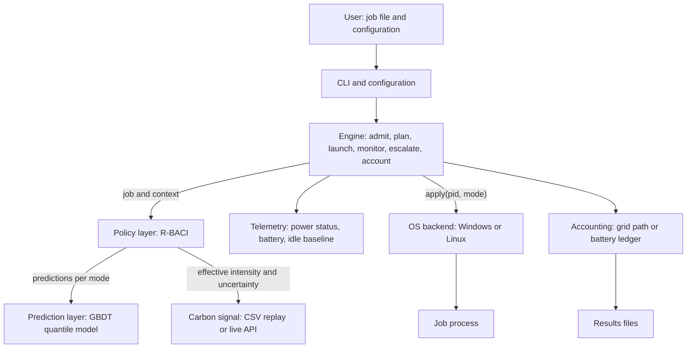
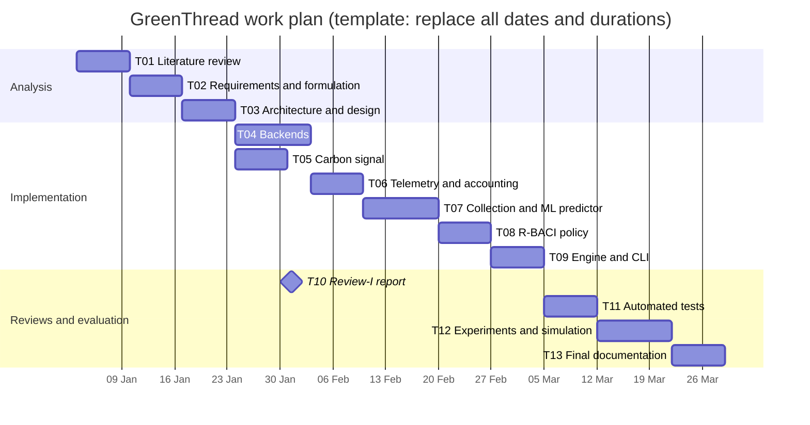

# Project Proposal Report

## GreenThread: A Carbon- and Battery-Aware Multicore Job Scheduler for Client Laptops

> **How to use this document (remove before submission).**
> Text in square brackets, for example `[STUDENT NAME / ROLL NUMBER]`, is a placeholder that must be replaced with verified information. Lines beginning with **Completion note** explain what is required and can be deleted once the section is complete. Project facts such as the module names, algorithm name (R-BACI), and technology stack were taken from the project repository (`README.md`, `docs/RESEARCH.md`, `pyproject.toml`) and should be checked against the version of the project that is formally proposed. This proposal describes **intended** work and is written in the future tense. It does not report results.

---

## 1. Cover Page

| Field | Details |
|---|---|
| Report title | Project Proposal Report |
| Project title | GreenThread: A Carbon- and Battery-Aware Multicore Job Scheduler for Client Laptops |
| Project subtitle | Risk-Bounded Battery- and Carbon-Intensity-Aware (R-BACI) Scheduling on Windows 11 and Linux |
| Course name and code | [COURSE NAME AND CODE, e.g. the Operating Systems Laboratory course for which the project is submitted] |
| Student name(s) and roll number(s) | [STUDENT NAME / ROLL NUMBER] (add one row per team member if required) |
| Degree and programme | [DEGREE AND PROGRAMME, e.g. B.Tech. Computer Science and Engineering] |
| Department and institution | [INSTITUTION / DEPARTMENT] |
| Faculty guide / project supervisor | [FACULTY GUIDE NAME], [DESIGNATION] |
| Academic year and semester | [ACADEMIC YEAR], [SEMESTER] |
| Submission date | [SUBMISSION DATE: DD Month YYYY] |
| Document version | [VERSION, e.g. 1.0] |

---

## 2. Abstract

> **Completion note:** Keep the final abstract to 200-300 words. Do not describe expected outcomes as achieved results.

**Background and context.** Laptops often run CPU-intensive background jobs, such as backups, file indexing, media exports, software builds, and model training, whose start times are flexible. These jobs share the processor with latency-sensitive interactive work. The operating system scheduler optimises responsiveness and local power use, but it does not take into account the carbon intensity of the electricity supplied by the grid, the carbon cost of the energy already stored in the battery, or how much slack each job has before its deadline.

**Problem.** As a result, flexible jobs are normally started immediately and at full speed, regardless of whether the grid is currently carbon-intensive, whether the battery is low, or whether the job could finish on time if it were started later or run in a more energy-efficient mode.

**Proposed solution.** This project proposes GreenThread, a user-mode scheduler for CPU-intensive jobs. For each job, GreenThread will decide when to start it (only if the user has explicitly marked it as deferrable) and how to run it: with default operating system scheduling, with Windows EcoQoS or the equivalent Linux scheduling class, restricted to half of the physical cores, or on efficiency cores where the processor has them. The decision is made by a constrained optimisation policy called R-BACI (Risk-Bounded Battery- And Carbon-Intensity-aware scheduling).

**Proposed methodology.** The system will combine (i) a machine-learning runtime predictor that produces median and calibrated upper-quantile runtimes for each execution mode, (ii) a carbon-intensity signal that adjusts how far it trusts each forecast according to the forecast's measured past error, (iii) a battery carbon ledger that charges battery energy at the carbon intensity of the grid when that energy was stored, and (iv) operating system controls accessed through documented Win32 APIs and Linux system calls. The system will be evaluated against the default OS scheduler and simpler heuristics, using real-process experiments and trace-driven simulation.

**Expected outcomes and significance.** The project is expected to produce a working scheduler, a set of reproducible experiments, and an evidence-based assessment of whether carbon- and battery-aware scheduling on a single client device can reduce attributable carbon emissions and battery energy use without increasing deadline misses or interactive latency. [INSERT PROJECT-SPECIFIC DESCRIPTION: one sentence on the intended academic or practical significance, as agreed with the faculty guide.]

**Keywords:** carbon-aware computing, CPU scheduling, battery-aware scheduling, EcoQoS, quantile regression, operating systems.

---

## 3. Table of Contents

1. [Cover Page](#1-cover-page)
2. [Abstract](#2-abstract)
3. [Table of Contents](#3-table-of-contents)
4. [Introduction](#4-introduction)
5. [Problem Statement](#5-problem-statement)
6. [Aim and Objectives](#6-aim-and-objectives)
7. [Project Scope](#7-project-scope)
8. [Literature Review and Background Study](#8-literature-review-and-background-study)
9. [Proposed Solution](#9-proposed-solution)
10. [Proposed System Architecture](#10-proposed-system-architecture)
11. [Methodology](#11-methodology)
12. [Functional and Non-Functional Requirements](#12-functional-and-non-functional-requirements)
13. [Tools, Technologies, and Software](#13-tools-technologies-and-software)
14. [Feasibility Analysis](#14-feasibility-analysis)
15. [Work Plan and Timeline](#15-work-plan-and-timeline)
16. [Team Member Responsibilities](#16-team-member-responsibilities)
17. [Expected Outcomes and Deliverables](#17-expected-outcomes-and-deliverables)
18. [Preliminary Risk Analysis](#18-preliminary-risk-analysis)
19. [Conclusion](#19-conclusion)
20. [References](#20-references)
21. [Appendices](#21-appendices)

---

## 4. Introduction

### 4.1 Background of the Project Domain

CPU scheduling is a core operating system function. It determines which process runs, on which core, and with what priority or quality-of-service (QoS) level. Modern client operating systems provide user-mode controls that influence these decisions without changing the kernel. On Windows 11, these include process power throttling (EcoQoS), priority classes, CPU Sets, affinity masks, and Job Objects. On Linux, they include scheduling policies such as `SCHED_BATCH`, utilisation clamping, and CPU affinity.

At the same time, the carbon intensity of grid electricity, measured in grams of CO2-equivalent per kilowatt-hour (gCO2e/kWh), changes considerably over the course of a day as the generation mix changes. Carbon-aware computing aims to shift flexible computation into periods of lower carbon intensity [1], [2].

### 4.2 Context and Motivation

Most research on carbon-aware scheduling has focused on data centres and cloud clusters [1]-[5]. Client devices differ from these environments in three ways that matter for scheduling:

1. **Batteries.** A laptop running on battery uses energy that was drawn from the grid earlier, possibly at a different carbon intensity.
2. **Interactive users.** Background work must not reduce the responsiveness of the foreground application.
3. **Limited, OS-specific controls.** Only user-mode, documented controls can be used without administrator rights, drivers, or kernel changes.

The closest deployed client-side system identified so far is carbon-aware Windows Update [6]. It applies to a single type of workload and does not take user deadlines or battery energy accounting into account.

### 4.3 Why the Problem Matters

[INSERT PROJECT-SPECIFIC DESCRIPTION: two or three sentences, supported by verified references, explaining why reducing the carbon footprint and battery drain of client-side computation matters. For example, cite a verified source on the scale of client-device energy use or on the variability of grid carbon intensity in the target region.]

> **Completion note:** Statistics on energy use or emissions must be taken from a verified source and cited. Do not include unsourced figures.

### 4.4 Overview of the Proposed Project

GreenThread will be a Python package with a command-line interface. The user submits jobs, for example from a JSON job file. For each job, GreenThread will:

- predict the job's runtime and energy use in each execution mode the hardware supports;
- obtain current and forecast grid carbon intensity, either from a recorded trace or from a live API;
- select a start time and execution mode that minimise a weighted cost, subject to a deadline constraint based on the upper-quantile runtime prediction;
- launch the job as a real operating system process, apply the selected controls, monitor its progress, and switch it to full speed if its deadline is at risk;
- record the job's energy use and attributable carbon emissions.

### 4.5 Intended Users and Stakeholders

| Stakeholder | Interest in the project |
|---|---|
| Laptop users who run CPU-intensive background jobs | Lower battery drain and lower emissions without missed deadlines |
| Developers and researchers | Reusable scheduler, baselines, and evaluation framework |
| Course faculty and examiners | Demonstration of operating system concepts through implementation and evaluation |
| [INSERT ADDITIONAL STAKEHOLDER, if applicable] | [INSERT PROJECT-SPECIFIC DESCRIPTION] |

### 4.6 Brief Explanation of the Proposed Solution

The proposed solution has two layers. The first is a **prediction layer**, a gradient-boosted quantile regression model that estimates runtime and energy for each execution mode. The second is a **policy layer**, the R-BACI scheduler, which chooses a start time and execution mode for each job. An **engine** carries out the policy's decisions on real processes through platform-specific **backends** for Windows and Linux. An **accounting** component attributes carbon emissions to each job. On mains power (AC), it uses the grid's carbon intensity at the time the job runs. On battery, it uses the battery carbon ledger.

---

## 5. Problem Statement

### 5.1 The Problem Being Addressed

Default OS scheduling starts flexible CPU-intensive jobs immediately and runs them at full speed. It does not use any information about grid carbon intensity, the carbon cost of stored battery energy, or the slack available before each job's deadline.

### 5.2 Existing Difficulties and Limitations

| Difficulty | Description |
|---|---|
| Carbon intensity is not considered | The OS scheduler has no access to grid carbon intensity |
| Battery energy is accounted for inaccurately | Energy drawn from the battery is usually treated either as carbon-free or as if it came from the grid at the time of use. Both approaches misstate its carbon cost |
| Runtimes are unknown | Deferring or throttling a job safely requires knowing how long the job will take in each mode. These runtimes are uncertain and depend on the machine |
| Carbon signals are unreliable | Forecasts may be stale, missing (for example, on free API tiers), or inaccurate |
| Interactive work must be protected | Throttling or delaying the wrong process reduces responsiveness |

### 5.3 Who Experiences the Problem

Users of laptops running Windows 11 or Linux who run deferrable, CPU-intensive background jobs, and especially users who frequently work on battery power.

### 5.4 Why Existing Approaches May Be Insufficient

Carbon-aware scheduling for data centres usually assumes elastic resources across multiple servers, job runtimes that are known in advance, and no device battery [1], [4], [5]. Power-saver rules on client devices, such as "use the efficiency mode when on battery", do not consider deadlines or carbon intensity. A recent large-scale trace study also reports that the achievable reductions from temporal workload shifting are limited [2]. This suggests that time shifting alone is insufficient and that it should be combined with the choice of energy-efficient execution modes. A detailed comparison is given in [Section 8](#8-literature-review-and-background-study).

### 5.5 Consequences of Leaving the Problem Unresolved

- Flexible jobs continue to run during periods of high carbon intensity even when a cleaner period would still meet their deadlines.
- Battery charge is used by jobs that could have been run more efficiently.
- The carbon cost of battery-powered computation remains misstated.

### 5.6 Concise Problem Statement

> On a single laptop running Windows 11 or Linux, CPU-intensive jobs with flexible timing are started immediately and run at full speed, because the operating system scheduler does not take into account grid carbon intensity, the carbon cost of stored battery energy, or each job's deadline slack. This project will investigate whether a user-mode scheduler can reduce attributable carbon emissions and battery energy use by choosing each job's start time and execution mode, using calibrated runtime predictions and uncertainty-aware carbon signals, without increasing deadline misses or interactive latency.

---

## 6. Aim and Objectives

### 6.1 Overall Aim

To design, implement, and evaluate a user-mode, carbon- and battery-aware multicore job scheduler for client laptops that reduces attributable carbon emissions and battery energy use while protecting job deadlines and interactive responsiveness.

### 6.2 Primary Objectives

| ID | Objective |
|---|---|
| O1 | Implement a user-mode scheduler that controls real processes on Windows 11 and Linux using only documented, unprivileged OS controls |
| O2 | Develop a machine-learning predictor of runtime (median and calibrated 90th-percentile), CPU time, and energy for each execution mode |
| O3 | Implement a carbon-intensity signal that measures the accuracy of its own past forecasts and adjusts how far it trusts each forecast accordingly |
| O4 | Implement the R-BACI policy with a risk-bounded deadline constraint and uncertainty-robust selection of the execution mode |
| O5 | Implement a battery carbon ledger that charges battery energy at the carbon intensity of the grid when that energy was stored |
| O6 | Evaluate the scheduler against baselines and ablations using real-process experiments and trace-driven simulation |

### 6.3 Secondary Objectives

| ID | Objective |
|---|---|
| O7 | Make sure interactive jobs are never deferred or throttled, and that deadline misses do not increase compared with the default OS scheduler |
| O8 | Deliver documentation, automated tests, a user manual, and a reproducible evaluation pipeline |

### 6.4 Functional Objectives

- Accept job descriptions that specify the workload type, size, number of threads, arrival time, deadline, and whether the job is deferrable or interactive.
- Detect the hardware's capabilities and the execution modes it supports.
- Select, apply, monitor, and escalate execution modes for each job.
- Report energy use, carbon emissions, delay, and deadline outcomes for each job.

### 6.5 Technical Objectives

- Make Win32 API calls through `ctypes` with 64-bit-safe function signatures. On Linux, use `sched_setattr`, `sched_setaffinity`, and `sysfs`.
- Train the model with quantile loss and calibrate the upper quantile on held-out data.
- Keep each scheduling decision fast enough not to delay job admission noticeably ([INSERT TARGET DECISION LATENCY, to be agreed]).
- Make sure every OS control degrades gracefully if it is not supported on the machine.

### 6.6 Objective Verification Table

| Objective ID | Objective | Expected evidence | Verification method |
|---|---|---|---|
| O1 | User-mode scheduler controlling real processes | `detect --probe` output showing each control applied; logs of the actions applied | Live control probe; unit tests against a mock `kernel32`; demonstration |
| O2 | ML runtime and energy predictor | Held-out accuracy metrics and quantile coverage | Temporal train/calibration/test split; comparison with a lookup-table baseline |
| O3 | Self-calibrating carbon signal | Table of learned confidence by forecast lead time; stress-test results | Unit tests; simulation with noisy, stale, and shifted forecasts |
| O4 | R-BACI policy | Decision logs with cost breakdowns; ablation results | Policy property tests; experiments with tight deadlines |
| O5 | Battery carbon ledger | Ledger state file; field log; charging-habit study | Unit tests; comparison of accounting methods |
| O6 | Evaluation against baselines | Results tables with confidence intervals | Real-process experiments and trace-driven simulation |
| O7 | Protection of deadlines and interactivity | Deadline-miss rate; 95th-percentile interactive latency | Comparison with the `default` policy |
| O8 | Documentation and tests | Repository, user manual, test report | Review by the faculty guide |

### 6.7 Measurable Success Criteria

> **Completion note:** Agree these thresholds with the faculty guide before implementation begins. Do not fill them in after the results are known.

| Criterion ID | Success criterion | Target value | Related objective |
|---|---|---|---|
| SC1 | Reduction in attributable carbon on AC compared with `default` | [INSERT TARGET, e.g. a confidence-interval lower bound above 0 %] | O4, O6 |
| SC2 | Deadline-miss rate compared with `default` | [INSERT TARGET, e.g. no more than X percentage points higher] | O7 |
| SC3 | Predictor accuracy compared with the table baseline | [INSERT TARGET METRIC AND VALUE, e.g. lower MAPE] | O2 |
| SC4 | Coverage of the 90th-percentile runtime prediction | [INSERT TARGET, e.g. close to 0.9 on the temporal test split] | O2 |
| SC5 | Interactive latency (95th percentile) | [INSERT TARGET, e.g. no measurable increase compared with `default`] | O7 |
| SC6 | Energy saving on battery compared with an always-EcoQoS rule | [INSERT TARGET] | O4, O5 |

---

## 7. Project Scope

### 7.1 In-Scope Features

| Feature | Category |
|---|---|
| JSON job files with deferrable, interactive, and deadline fields | Minimum viable implementation |
| Detection of capabilities (CPU topology, CPU Sets, efficiency classes, EcoQoS, battery) | Minimum viable implementation |
| Execution modes NORMAL, ECO, HALF, ECO_HALF, and BOOST (escalation) | Minimum viable implementation |
| Carbon intensity from replayed CSV traces | Minimum viable implementation |
| ML quantile predictor and lookup-table baseline | Minimum viable implementation |
| R-BACI policy and baseline policies | Minimum viable implementation |
| Engine that launches, monitors, escalates, and accounts for real processes | Minimum viable implementation |
| Battery carbon ledger | Minimum viable implementation |
| Windows 11 backend | Minimum viable implementation |
| Live carbon intensity from the Electricity Maps API | Optional enhancement |
| Linux backend | Optional enhancement |
| ECORES mode for hybrid CPUs | Optional enhancement (depends on hardware) |
| Trace-driven simulator and ablation suite | Optional enhancement |
| Automatically generated test report and HTML dashboard | Optional enhancement |

### 7.2 Out-of-Scope Features

- Changes to the kernel, drivers, or OS scheduler internals.
- Features that require administrator rights, apart from optional RAPL access on Linux.
- Scheduling across multiple machines or in the cloud.
- Measuring energy use for individual threads (Windows does not expose this).
- Using marginal rather than average carbon intensity signals.
- Scheduling GPU workloads.

### 7.3 Intended Users

Users of a single laptop running Windows 11 or Linux, with Python 3.11 or later, operating without administrator rights.

### 7.4 Assumptions

| ID | Assumption |
|---|---|
| A1 | The user explicitly marks which jobs may be deferred, and gives them deadlines |
| A2 | The workloads are CPU-bound and can be reproduced to collect training data |
| A3 | Grid carbon intensity is available from a trace or an API, at hourly or finer resolution |
| A4 | Battery capacity readings are available on the target laptop (if not, an estimated power model is used instead) |
| A5 | [INSERT ADDITIONAL ASSUMPTION] |

### 7.5 Constraints

| ID | Constraint |
|---|---|
| C1 | No administrator rights, drivers, WSL, virtual machines, dual booting, or kernel changes |
| C2 | Only documented OS APIs may be used |
| C3 | Hardware is limited to the team's own laptops: [INSERT LAPTOP MODEL(S) AND CPU(S)] |
| C4 | The project must be completed within the academic schedule ([ACADEMIC YEAR], [SEMESTER]) |
| C5 | The free tier of the live carbon API may not provide forecasts |

### 7.6 Dependencies

- Python 3.11 or later, and the libraries listed in [Section 13](#13-tools-technologies-and-software).
- Win32 APIs available in Windows 11, or Linux kernel features (`sched_setattr`, `sysfs`, and optionally RAPL).
- Published carbon-intensity traces (from [1]) and, optionally, an Electricity Maps API token [9].

### 7.7 Expected Deliverables

Source code, automated tests, configuration files and job files, a user manual, a test and results report, this proposal, the Review-I design and progress report, the final report, and a presentation.

---

## 8. Literature Review and Background Study

> **Completion note:** The sources below are listed in the project's `docs/RESEARCH.md` as having been checked. Before submission, confirm every bibliographic detail (author initials, venue, pages, DOI) against the publisher's page, and add any further sources required by the faculty guide.

### 8.1 Background Concepts

| Concept | Description |
|---|---|
| Carbon intensity | Grams of CO2-equivalent emitted per kWh of electricity consumed; changes with the generation mix |
| Temporal workload shifting | Delaying flexible work until carbon intensity is lower [1] |
| EcoQoS | A Windows process power-throttling QoS level that lowers clock frequency or prefers efficient cores [8] |
| CPU Sets and affinity | Mechanisms that restrict a process to a chosen subset of logical processors |
| Quantile regression | Predicting a chosen percentile of an outcome, such as the 90th-percentile runtime, rather than its mean |
| Battery carbon ledger | An energy-weighted record of the carbon intensity of the energy currently stored in the battery |

### 8.2 Existing Methods and Solutions

Existing approaches fall into four groups: (a) temporal and spatial shifting in data centres [1], [2], [5]; (b) virtual energy systems and elastic scaling in the cloud [3], [4]; (c) carbon-aware features in client operating systems [6]; and (d) energy-efficient allocation on hybrid processors [10], [11].

### 8.3 Review of Relevant Research

| Ref. | Author / Year | Paper or system | Approach | Key findings | Limitations | Relevance to this project |
|---|---|---|---|---|---|---|
| [1] | Wiesner et al., 2021 | Let's Wait Awhile | Analysis and simulation of temporal shifting for delay-tolerant jobs | Temporal shifting can reduce emissions, depending on the region and forecast accuracy | Limited to data centres; runtimes assumed known; no battery; no choice of execution mode | Source of the carbon traces; basis of the `carbon_only` baseline |
| [2] | Sukprasert et al., 2024 | Limitations of carbon-aware shifting | Trace analysis across many regions | Practical reductions are limited, and simple policies capture most of the benefit (stated by the authors) | Cloud scope | Sets realistic expectations; motivates combining shifting with mode selection |
| [3] | Souza et al., 2023 | Ecovisor | Virtual grid, solar, and battery exposed to applications | Gives applications control over their energy supply | Requires a controllable energy system; not a client OS | Closest idea to treating a battery as time-shifted energy |
| [4] | Hanafy et al., 2024 | CarbonScaler | Scales elastic jobs according to carbon intensity | Elastic scaling improves carbon efficiency | Requires elastic jobs across multiple servers | Mode selection is a single-machine equivalent of scaling |
| [5] | Radovanović et al., 2021 | Carbon-Aware Computing for Datacenters | Day-ahead, carbon-aware capacity curves | Forecast-driven shifting is feasible at fleet scale | Operates at fleet level | Shows that risk-aware shifting is feasible |
| [6] | Microsoft, 2022 | Carbon-aware Windows Update | Installs updates when the grid is cleaner | Deployed in a client operating system | Single workload; closed policy; no deadlines | Closest client-side system |
| [7] | Kim et al., 2023 | GreenScale | Carbon-aware placement across mobile, edge, and cloud | Models mobile device carbon through charging behaviour | Placement across tiers, not an OS scheduler | Supports charging battery carbon at charge time |
| [10] | [VERIFY AUTHORS], 2024 | E-Mapper | User-space allocation on hybrid CPUs | Energy-efficient allocation on heterogeneous processors | Specific to hybrid CPUs | Relevant only to the optional ECORES mode |
| [11] | [VERIFY AUTHORS], 2024 | Energy efficiency of Intel Alder Lake | Hardware measurement | Characterises the energy behaviour of P-cores and E-cores | Hardware characterisation only | Relevant only to the optional ECORES mode |
| [12] | [INSERT VERIFIED REFERENCE: Author, title, publication, year, DOI/URL] | [INSERT] | [INSERT] | [INSERT] | [INSERT] | [INSERT] |

### 8.4 Comparison of Existing Approaches

| Capability | Data-centre shifting [1], [2] | Ecovisor [3] | CarbonScaler [4] | Carbon-aware Windows Update [6] | GreenThread (proposed) |
|---|---|---|---|---|---|
| Runs on a client device | No | No | No | Yes | Yes |
| User-defined deadlines | Partially | Not applicable | Yes | No | Yes |
| Choice of execution mode | No | No | Scaling | No | Yes |
| Battery carbon accounting | No | Physical battery control | No | No | Yes (ledger) |
| Handles carbon-forecast uncertainty | Simulation study | [VERIFY] | [VERIFY] | Not documented | Yes (self-calibrating signal) |
| Uses learned runtime prediction | No (runtimes assumed known) | [VERIFY] | [VERIFY] | Not applicable | Yes (quantile model) |

> **Completion note:** Replace each `[VERIFY]` cell only after reading the relevant paper.

### 8.5 Identified Limitations and Research Gaps

| Gap ID | Gap | Supporting evidence |
|---|---|---|
| G1 | No client-device scheduler was found that charges battery-powered execution at the carbon intensity of the stored energy | [1], [3], [7] (narrow claim, based on the search carried out) |
| G2 | When deferring or throttling jobs on a client device, the deadline check is not based on calibrated upper-quantile runtime predictions for each mode | [1] assumes known runtimes |
| G3 | There is limited treatment of carbon signals that judge how far to trust themselves on a client device | [1] studies forecast error in simulation |
| G5 | Execution modes are chosen from noisy predictions without protection against the winner's curse (selecting whichever noisy estimate happens to look best) | [INSERT VERIFIED REFERENCE on mode or DVFS selection under uncertainty] |
| G4 | Placement on hybrid P-cores and E-cores is already well covered by existing work | [10], [11]; it is not a research claim of this project |

### 8.6 How the Proposed Project Addresses the Gaps

R-BACI combines G1 (battery carbon ledger), G2 (deadline check based on upper-quantile runtime predictions), G3 (self-calibrating carbon signal), and G5 (robust mode selection) in a single constrained scheduler. G1 is the primary novelty claim. G2, G3, and G5 adapt known statistical ideas, and each will be isolated by an ablation experiment. The project does **not** claim to be the first carbon-aware scheduler, and it does not expect large savings, given the findings of [2].

---

## 9. Proposed Solution

### 9.1 The Proposed System

GreenThread will be a user-mode scheduler, run from the command line (`python -m greenthread ...`), that manages CPU-intensive jobs as child processes.

### 9.2 How It Addresses the Problem

| Problem aspect | Proposed mechanism |
|---|---|
| The OS does not consider carbon intensity | Defer deferrable jobs into windows with lower forecast carbon intensity (on AC only) |
| Battery carbon is misstated | Battery carbon ledger used for accounting on battery |
| Runtimes are unknown | ML predictor of median and 90th-percentile runtime for each mode |
| Carbon signals are unreliable | Each forecast is weighted toward the typical value for that hour of day, according to its measured error at that lead time |
| Interactivity must be protected | Interactive jobs are never deferred or throttled; jobs are escalated to BOOST if their deadline is at risk |

### 9.3 Main Features (Planned)

1. Hardware capability detection with a live probe of each control.
2. Six execution modes: NORMAL, ECO, HALF, ECO_HALF, ECORES (only on hybrid CPUs), and BOOST (used only for escalation).
3. Carbon intensity sources: CSV replay, a static value, or the live Electricity Maps API.
4. The R-BACI policy, five baseline policies, and ablation variants.
5. Per-job accounting of energy and carbon.
6. Data collection, model training, experiments, simulation, and report generation commands.

### 9.4 Expected Workflow

1. The user writes a job file and a configuration file.
2. The user runs `detect`, `collect`, and `train` once on the target machine.
3. The user runs `run` (or `experiment`) with a chosen policy.
4. For each job, the engine obtains predictions and carbon-intensity values, asks the policy for a start time and mode, launches the job, and applies the controls.
5. The engine monitors each running job, escalates it if necessary, and records its results.

### 9.5 Intended User Interaction

Interaction will take place through the command line and through configuration files (TOML for configuration, JSON for job files). Results will be written to CSV, JSON Lines, and Markdown files in a `results/` directory.

### 9.6 Expected Advantages over Existing Approaches

- Runs on a single laptop without administrator rights.
- Combines when to start a job with how to run it.
- Accounts explicitly for the carbon intensity of energy stored in the battery.
- Degrades gracefully when carbon signals are poor.

> **Completion note:** These are expected advantages. They must not be stated as results until they are supported by the evaluation.

[INSERT DIAGRAM: Figure 9.1. High-level overview of the proposed solution, showing the user's job file entering GreenThread, the prediction and policy layers, the OS controls applied to the job process, and the carbon and energy accounting output.]

---

## 10. Proposed System Architecture

> **Status: Proposed.** This architecture is preliminary and may be revised during design (see the Review-I report).

### 10.1 Layers and Components

| Layer | Component (planned module) | Responsibility |
|---|---|---|
| Interface | CLI and configuration (`cli.py`, `config.py`) | Parse commands; load and validate TOML configuration |
| Orchestration | Engine (`engine.py`, `jobs.py`) | Admit, plan, launch, monitor, escalate, and account for jobs |
| Decision | Policy (`policy.py`) | R-BACI, baseline policies, and ablations |
| Prediction | Predictor (`model.py`) | GBDT quantile model and table baseline |
| Signals | Carbon signal (`carbon.py`) | Trace replay, live API client, confidence weighting |
| Signals | Telemetry (`telemetry.py`) | Power status, battery sampling, idle baseline, power model |
| Accounting | Accounting (`accounting.py`) | Battery carbon ledger; carbon attribution |
| Platform | Backends (`backends/windows.py`, `backends/posix.py`) | Apply OS controls and detect hardware capabilities |
| Evaluation | Collection, experiments, simulator, report | Training data, comparisons, and reporting |

### 10.2 Data Flow

Job file, then engine, then predictor (one prediction per mode), then policy (which also uses the carbon signal and the power status), then a decision (start time and mode), then the backend (which applies the controls), then the job process, then monitoring, then accounting, and finally the results files.

### 10.3 Integrations and External Dependencies

- Win32 functions accessed through `ctypes`: `SetProcessInformation`, `SetPriorityClass`, `SetProcessDefaultCpuSets`, `SetProcessAffinityMask`, Job Objects, `GetSystemCpuSetInformation`, `GetSystemPowerStatus`, and the WMI battery classes.
- Linux interfaces: `sched_setattr`, `sched_setaffinity`, `/sys/class/power_supply`, and the RAPL `energy_uj` counter.
- The Electricity Maps API v3 (optional) [9].

### 10.4 Proposed Architecture Diagram (Editable Template)



[INSERT DIAGRAM: Figure 10.1. Final version of the proposed architecture, redrawn in the report's figure style if required by the institution.]

---

## 11. Methodology

### 11.1 Development Methodology

[INSERT PROJECT-SPECIFIC DESCRIPTION: the chosen methodology, for example iterative or incremental development with a working prototype at each review, and a one-sentence justification.]

### 11.2 Stages, Purpose, and Deliverables

| Stage | Purpose | Expected deliverable |
|---|---|---|
| 1. Requirement gathering | Identify the workloads, OS controls, and evaluation needs | Requirements list ([Section 12](#12-functional-and-non-functional-requirements)) |
| 2. Problem analysis | Formulate the research question and hypotheses; review the literature | Problem statement, gap table, hypotheses |
| 3. System design | Define the architecture, modules, R-BACI formulation, and data formats | Design section of the Review-I report |
| 4. Technology selection | Choose the language, libraries, APIs, and data sources | Technology table ([Section 13](#13-tools-technologies-and-software)) |
| 5. Implementation | Build the backends, signals, predictor, policy, engine, and accounting | Source code under version control |
| 6. Integration | Connect the modules into an end-to-end CLI workflow | Working `run` and `experiment` commands |
| 7. Testing | Unit, property, integration, and mock-backend tests | Automated test suite and its output |
| 8. Evaluation | Real-process experiments and trace-driven simulation against baselines and ablations | Results tables and hypothesis verdicts |
| 9. Documentation | Reports, user manual, presentation | Final report and user manual |

### 11.3 Planned Evaluation Approach

- **Baseline policies:** `default` (unmodified OS scheduling), `heuristic` (ECO on battery), `carbon_only`, `battery_only`, and `combined_noai`.
- **Ablations:** variants of GreenThread with one component removed, for example without the quantile constraint or without the ML predictor.
- **Planned hypotheses:** H1 (carbon reduction on AC), H2 (deadline safety of the quantile constraint), H3 (handling of uncertain carbon signals), H4 (ML predictor compared with the table baseline), H5 (battery behaviour), H6 (effect of the battery ledger), and H7 (whether EcoQoS actually saves energy on the target hardware). The full statements will be given in the Review-I report.

---

## 12. Functional and Non-Functional Requirements

> **Completion note:** These requirement identifiers are used in all three reports. Do not renumber them. If you add a requirement, append a new identifier.

### 12.1 Functional Requirements

| ID | Requirement | Priority | Verification criterion |
|---|---|---|---|
| FR-01 | The system shall load jobs from a JSON job file with the fields id, kind, units, threads, arrival, deadline (absolute or as a factor of predicted runtime), deferrable, and interactive | High | A job file is parsed into job objects; invalid keys are rejected |
| FR-02 | The system shall detect the CPU topology, CPU Sets and efficiency classes, EcoQoS support, battery presence, and the supported execution modes | High | `detect` output matches the hardware; mocked tests |
| FR-03 | The system shall apply the NORMAL, ECO, HALF, ECO_HALF, ECORES, and BOOST modes to a process using user-mode OS controls | High | Live probe; tests against a mock `kernel32` and fake `sysfs` |
| FR-04 | The system shall obtain carbon intensity from CSV replay, a static value, or a live API, with caching and fallback | High | Unit tests; behaviour when the API is unavailable |
| FR-05 | The system shall compute an effective (confidence-weighted) carbon intensity and its uncertainty | High | Unit tests with good and misleading forecasts |
| FR-06 | The system shall predict the median and upper-quantile runtime, CPU time, and energy for each mode | High | Held-out accuracy metrics |
| FR-07 | The system shall select a start offset and mode for each job using R-BACI, subject to the risk-bounded deadline constraint | High | Policy property tests |
| FR-08 | The system shall never defer or throttle interactive jobs, and shall defer only jobs marked as deferrable | High | Policy property tests |
| FR-09 | The system shall launch, monitor, and escalate jobs to BOOST when their deadline is at risk, and shall terminate child processes on exit | High | Integration tests; demonstration |
| FR-10 | The system shall attribute energy and carbon to each job (grid path on AC, ledger path on battery) | High | Unit tests of the attribution rule |
| FR-11 | The system shall maintain a persistent battery carbon ledger | Medium | Unit tests; field log |
| FR-12 | The system shall provide baseline and ablation policies | Medium | All named policies can be built |
| FR-13 | The system shall run real-process experiments and trace-driven simulations | Medium | Generated summary files |
| FR-14 | The system shall generate a test and results report | Low | Generated report file |
| FR-15 | The system shall provide a CLI with commands for detection, collection, training, running, experiments, simulation, ledger operations, and reporting | High | Manual run of each command |

### 12.2 Non-Functional Requirements

| ID | Category | Requirement | Priority | Verification criterion |
|---|---|---|---|---|
| NFR-01 | Security and compatibility | The system shall run without administrator rights, drivers, or kernel changes | High | Run under a standard user account |
| NFR-02 | Portability | The system shall run on Windows 11 and Linux | High (Windows), Medium (Linux) | Test suite and probe on each OS |
| NFR-03 | Reliability | A failed OS control shall never prevent a job from running; failures shall be logged | High | Fault-injection unit tests |
| NFR-04 | Performance | A scheduling decision shall take no more than [INSERT TARGET] ms | Medium | Measured decision latency |
| NFR-05 | Usability and responsiveness | The 95th-percentile interactive latency shall not increase by more than [INSERT TARGET] compared with `default` | High | Interactive latency probe |
| NFR-06 | Reproducibility | Experiments shall use randomised order and fixed seeds; reports shall be generated from the results files | Medium | The same inputs produce the same report |
| NFR-07 | Maintainability | Modules shall have single responsibilities and docstrings, and shall be covered by automated tests | Medium | Code review; test suite |
| NFR-08 | Security | API tokens shall not be stored in version control | High | `.gitignore` check; environment-variable option |
| NFR-09 | Portability | Job files shall express deadlines relative to the predicted runtime on the machine | Low | `deadline_factor` test |
| NFR-10 | Usability | All commands shall be documented in a user manual | Medium | Review of the user manual |
| NFR-11 | Scalability | [INSERT REQUIREMENT, e.g. maximum number of concurrent jobs] | [INSERT] | [INSERT] |

---

## 13. Tools, Technologies, and Software

> **Completion note:** Versions are minimum versions from `requirements.txt` and `pyproject.toml`. Record the exact installed versions (`pip freeze`) in the Review-I report.

| Category | Technology | Purpose | Justification | Status |
|---|---|---|---|---|
| Programming language | Python 3.11 or later | Implementation of all modules | Cross-platform; `ctypes` gives access to Win32; includes `tomllib` for TOML | Selected |
| Numerical library | NumPy 1.26 or later | Vectorised cost evaluation | Fast array operations | Selected |
| Data handling | pandas 2.1 or later | Training data and results tables | Standard tabular processing | Selected |
| Machine learning | scikit-learn 1.3 or later | `HistGradientBoostingRegressor` with quantile loss | Mature, supports quantile loss [13] | Selected |
| Scientific computing | SciPy 1.11 or later | Statistics and confidence intervals | Standard library for statistics | Selected |
| System monitoring | psutil 5.9 or later | CPU times, processes, background load | Works on both Windows and Linux | Selected |
| Plotting | Matplotlib 3.8 or later | Simulation plots | Standard plotting library | Selected |
| Windows OS interface | `ctypes` and the Win32 API | EcoQoS, priority, CPU Sets, affinity, Job Objects, power status | Documented APIs that require no administrator rights [8] | Selected |
| Linux OS interface | `sched_setattr`, `sched_setaffinity`, `sysfs`, RAPL | Linux equivalents of the execution modes | User-mode interfaces | Selected (optional scope) |
| External API | Electricity Maps API v3 | Live carbon intensity | Data available by zone, including Indian zones [9] | Selected (optional scope) |
| Dataset | Hourly carbon-intensity traces for 2020 (DE, GB, FR, US-CAL) | Replay and simulation | Published with [1] | Selected |
| Database | Not applicable; file-based storage (CSV, JSON, JSON Lines, pickle) | Persistent results and model | No multi-user or transactional requirement | Selected |
| Testing | pytest 8.0 or later | Automated tests | Standard Python test framework | Selected |
| Version control | Git | History and backup | Required by course guidelines | Selected |
| Development environment | [INSERT IDE, e.g. VS Code] | Editing and debugging | [INSERT JUSTIFICATION] | [Selected / Under consideration] |
| Hardware | [INSERT LAPTOP MODEL, CPU, RAM, OS BUILD] | Target machine for measurements | Has a battery and supports EcoQoS | [Selected / Under consideration] |
| Deployment | Local installation in a virtual environment using the setup scripts | Running on the target laptop | No server is required | Selected |
| Other | [INSERT ANY OTHER TOOL] | [INSERT] | [INSERT] | [INSERT] |

---

## 14. Feasibility Analysis

### 14.1 Technical Feasibility

The required OS controls are documented user-mode APIs [8]. The required libraries are open source and widely used. Real carbon-intensity traces are publicly available [1]. The main technical uncertainty is whether ECO mode actually reduces energy use on the target hardware. This will be tested as a hypothesis (H7) rather than assumed.

### 14.2 Operational Feasibility

The system is used from the command line with configuration files. It requires no administrator rights and runs on the team's own laptops. [INSERT PROJECT-SPECIFIC DESCRIPTION: any operational concerns, for example the need to unplug the laptop during battery measurements.]

### 14.3 Economic Feasibility

All software is free and open source. The live carbon-intensity API offers a free tier with limited features. No hardware needs to be purchased beyond the team's laptops. [INSERT ANY COSTS, or state "No costs anticipated".]

### 14.4 Schedule Feasibility

[INSERT PROJECT-SPECIFIC DESCRIPTION: a statement relating the work plan in Section 15 to the review dates set by the institution.]

### 14.5 Identified Risks and Mitigation (Summary)

The detailed risk register is given in [Section 18](#18-preliminary-risk-analysis). The main risks are hardware that does not support certain controls, insufficient measurement accuracy for short jobs, and limited access to the live API.

---

## 15. Work Plan and Timeline

> **Completion note:** Replace every date with the actual planned date. The status of every task in this proposal should be "Planned" unless work has genuinely started.

| Task ID | Task description | Planned start | Planned end | Duration | Dependencies | Expected deliverable | Status |
|---|---|---|---|---|---|---|---|
| T01 | Literature review and gap analysis | [DD-MM-YYYY] | [DD-MM-YYYY] | [N days] | None | Literature table, gaps | Planned |
| T02 | Requirements and R-BACI formulation | [DD-MM-YYYY] | [DD-MM-YYYY] | [N days] | T01 | Requirements, formulation | Planned |
| T03 | Architecture and module design | [DD-MM-YYYY] | [DD-MM-YYYY] | [N days] | T02 | Design document | Planned |
| T04 | Backends (Windows; Linux optional) and capability detection | [DD-MM-YYYY] | [DD-MM-YYYY] | [N days] | T03 | `backends/` and probe | Planned |
| T05 | Carbon signal (CSV replay; live API optional) | [DD-MM-YYYY] | [DD-MM-YYYY] | [N days] | T03 | `carbon.py` | Planned |
| T06 | Workloads, telemetry, and accounting (ledger) | [DD-MM-YYYY] | [DD-MM-YYYY] | [N days] | T04 | `workload.py`, `telemetry.py`, `accounting.py` | Planned |
| T07 | Data collection and ML predictor | [DD-MM-YYYY] | [DD-MM-YYYY] | [N days] | T04, T06 | `collect.py`, `model.py` | Planned |
| T08 | R-BACI policy and baseline policies | [DD-MM-YYYY] | [DD-MM-YYYY] | [N days] | T05, T07 | `policy.py` | Planned |
| T09 | Engine and CLI integration | [DD-MM-YYYY] | [DD-MM-YYYY] | [N days] | T04 to T08 | `engine.py`, `cli.py` | Planned |
| T10 | Review-I preparation (design and 40-50 % progress) | [DD-MM-YYYY] | [DD-MM-YYYY] | [N days] | T03, partial T04 to T09 | Review-I report | Planned |
| T11 | Automated tests | [DD-MM-YYYY] | [DD-MM-YYYY] | [N days] | T04 to T09 | `tests/` | Planned |
| T12 | Experiments and simulation | [DD-MM-YYYY] | [DD-MM-YYYY] | [N days] | T09, T11 | Results tables | Planned |
| T13 | Final report, user manual, presentation | [DD-MM-YYYY] | [DD-MM-YYYY] | [N days] | T12 | Final documentation | Planned |

**Editable Gantt chart template.** The dates and durations below are placeholder values that are required for the diagram to render. They are not a plan. Replace them before submission.



---

## 16. Team Member Responsibilities

> **Completion note:** Use Table 16.1 for a team project or Table 16.2 for an individual project, and delete the other.

**Table 16.1. Team project format**

| Team member | Roll number | Assigned role | Responsibilities | Expected deliverables |
|---|---|---|---|---|
| [STUDENT NAME 1] | [ROLL NUMBER] | [ROLE, e.g. OS backends lead] | [e.g. Windows and Linux backends, capability detection, live probe] | [e.g. `backends/`, backend tests] |
| [STUDENT NAME 2] | [ROLL NUMBER] | [ROLE, e.g. ML and policy lead] | [e.g. data collection, predictor, R-BACI policy] | [e.g. `model.py`, `policy.py`, accuracy report] |
| [STUDENT NAME 3] | [ROLL NUMBER] | [ROLE, e.g. engine and evaluation lead] | [e.g. engine, accounting, experiments, simulator] | [e.g. `engine.py`, results tables] |
| [STUDENT NAME 4] | [ROLL NUMBER] | [ROLE, e.g. documentation and testing lead] | [e.g. test suite, user manual, reports] | [e.g. `tests/`, documentation] |

**Table 16.2. Individual project format**

| Student | Roll number | Role | Responsibilities | Expected deliverables |
|---|---|---|---|---|
| [STUDENT NAME] | [ROLL NUMBER] | Sole developer and researcher | Literature review, design, implementation of all modules, testing, evaluation, documentation | All deliverables listed in [Section 17](#17-expected-outcomes-and-deliverables) |

---

## 17. Expected Outcomes and Deliverables

> **Status: Planned.** The items below are expected outcomes, not verified results.

| Deliverable | Description | Planned review |
|---|---|---|
| GreenThread software package | Python package with a CLI, backends, predictor, policy, engine, and accounting | Review I (partial), final (complete) |
| Automated test suite | Unit, property, integration, and mock-backend tests | Final |
| Configuration and job files | Demonstration and tight-deadline job files; live and replay configurations | Review I |
| Evaluation results | Real-process experiments and simulation results with hypothesis verdicts | Final |
| User manual | Installation, commands, configuration, and behaviour when components fail | Final |
| Reports | Proposal, Review-I design and progress report, final report | Each review |
| Presentation | Slides for the review and viva | [INSERT REVIEW] |

**Anticipated outcome.** An evidence-based answer, in either direction, to the research question in [Section 5.6](#56-concise-problem-statement).

---

## 18. Preliminary Risk Analysis

| Risk ID | Description | Likelihood | Impact | Mitigation | Contingency plan |
|---|---|---|---|---|---|
| R1 | ECO mode does not reduce energy use on the target laptop | [Low / Medium / High] | High | Measure it (H7) rather than assume it | Report the negative result; rely on deferral and HALF mode |
| R2 | Battery discharge readings are too coarse for short jobs | [L/M/H] | Medium | Scale workloads up for measurement on battery | Use the calibrated power model and label the values as estimates |
| R3 | The live API tier provides no forecast | [L/M/H] | Medium | Build a "same hour yesterday" forecast from the history | Use CSV replay |
| R4 | The ML predictor generalises poorly to unseen job sizes or other machines | [L/M/H] | Medium | Use a log-linear model plus a boosted residual; train locally | Use the table baseline |
| R5 | A control call fails or is not supported | [L/M/H] | Low | Detect capabilities; never block a job on a failed control | Run the job in NORMAL mode and log the failure |
| R6 | Schedule slippage | [L/M/H] | High | Deliver the minimum viable implementation first | Defer the optional enhancements |
| R7 | The target hardware is not available for measurements | [L/M/H] | High | Use a fallback test machine | Run the simulation and label the results clearly |
| R8 | [INSERT ADDITIONAL RISK] | [L/M/H] | [L/M/H] | [INSERT] | [INSERT] |

---

## 19. Conclusion

This proposal identifies a gap between carbon-aware scheduling research, which has mostly targeted data centres, and the scheduling of flexible CPU-intensive jobs on client laptops, where batteries, interactive users, and unprivileged OS controls change the problem. GreenThread will address this gap with the R-BACI policy, which combines calibrated runtime predictions, a self-calibrating carbon signal, robust mode selection, and a battery carbon ledger, implemented using documented Windows 11 and Linux controls. The scope is limited to a single device and to user-mode controls. Success will be judged against the criteria in [Section 6.7](#67-measurable-success-criteria), using real-process experiments and trace-driven simulation, and positive, negative, and inconclusive findings will all be reported. [INSERT PROJECT-SPECIFIC DESCRIPTION: one closing sentence on the anticipated significance, as agreed with the faculty guide.]

---

## 20. References

> **Completion note:** IEEE citation style is used in all three reports. Entries [1]-[11] are the sources recorded in `docs/RESEARCH.md`. Before submission, verify the author initials, page numbers, and access dates. Do not add any reference you have not read.

[1] Wiesner, Behnke, Scheinert, Gontarska, and Thamsen [VERIFY: author initials], "Let's Wait Awhile: How Temporal Workload Shifting Can Reduce Carbon Emissions in the Cloud," in *Proc. ACM/IFIP Middleware Conf. (Middleware '21)*, 2021, doi: 10.1145/3464298.3493399. [VERIFY: page numbers]

[2] Sukprasert, Souza, Bashir, Irwin, and Shenoy [VERIFY: author initials], "On the Limitations of Carbon-Aware Temporal and Spatial Workload Shifting in the Cloud," in *Proc. EuroSys '24*, 2024, doi: 10.1145/3627703.3650079.

[3] Souza *et al.* [VERIFY: full author list], "Ecovisor: A Virtual Energy System for Carbon-Efficient Applications," in *Proc. ASPLOS '23*, 2023, doi: 10.1145/3575693.3575709.

[4] Hanafy *et al.* [VERIFY: full author list], "CarbonScaler: Leveraging Cloud Workload Elasticity for Optimizing Carbon-Efficiency," *Proc. ACM Meas. Anal. Comput. Syst. (SIGMETRICS '24)*, 2024, doi: 10.1145/3626788.

[5] Radovanović *et al.* [VERIFY: full author list], "Carbon-Aware Computing for Datacenters," arXiv:2106.11750, 2021.

[6] Microsoft, "Windows Update is now carbon aware," Microsoft Support. [INSERT VERIFIED REFERENCE: URL and access date]

[7] Kim *et al.* [VERIFY: full author list], "GreenScale: Carbon-Aware Systems for Edge Computing," arXiv:2304.00404, 2023.

[8] Microsoft, "SetProcessInformation function (processthreadsapi.h)," Microsoft Learn; together with the documentation for JOBOBJECT_CPU_RATE_CONTROL_INFORMATION and CPU Sets. [INSERT VERIFIED REFERENCE: URLs and access date]

[9] Electricity Maps, "Electricity Maps API v3 documentation." [INSERT VERIFIED REFERENCE: URL and access date]

[10] [VERIFY: authors], "E-Mapper: Energy-Efficient Resource Allocation for Traditional Operating Systems on Heterogeneous Processors," arXiv:2406.18980, 2024.

[11] [VERIFY: authors], "Energy Efficiency Features of the Intel Alder Lake Architecture," in *Proc. ACM/SPEC ICPE '24*, 2024. [INSERT VERIFIED REFERENCE: DOI]

[12] [INSERT VERIFIED REFERENCE: Author, title, publication, year, DOI/URL]

[13] [INSERT VERIFIED REFERENCE: scikit-learn, e.g. the JMLR paper by Pedregosa et al. (2011) or the official documentation for HistGradientBoostingRegressor, with URL and access date]

---

## 21. Appendices

### Appendix A: Requirement Notes

[INSERT PROJECT-SPECIFIC DESCRIPTION: notes from requirement discussions with the faculty guide, including dates and agreed changes.]

### Appendix B: Preliminary Sketches

[INSERT DIAGRAM: Figure B.1. Hand-drawn or digital preliminary sketch of the scheduling timeline, showing a deferrable job being moved into a period of lower carbon intensity before its deadline.]

### Appendix C: Example Job File (Format Illustration Only)

The following example illustrates the planned input format. It is not a test result.

```json
{"jobs": [
  {"id": "backup", "kind": "compress", "units": 600, "threads": 1,
   "arrival_s": 0, "relative_deadline_s": 7200, "deferrable": true},
  {"id": "ui", "kind": "probe", "units": 60, "arrival_s": 0, "interactive": true}
]}
```

### Appendix D: Carbon-Intensity Data Sources

| Trace | Region | Year | Source | Nature |
|---|---|---|---|---|
| `de_2020_hourly.csv` | Germany | 2020 | Published with [1] (ENTSO-E data) | Real |
| `gb_2020_hourly.csv` | Great Britain | 2020 | Published with [1] | Real |
| `fr_2020_hourly.csv` | France | 2020 | Published with [1] | Real |
| `us-cal_2020_hourly.csv` | California | 2020 | Published with [1] (CAISO data) | Real |
| `in-so_synthetic_2020_hourly.csv` | Southern India | 2020 shape | Generated for illustration | **Synthetic; must not be presented as measured data** |

### Appendix E: Additional Supporting Documents

[INSERT any additional tables, approval forms, or supporting documents required by the institution.]
