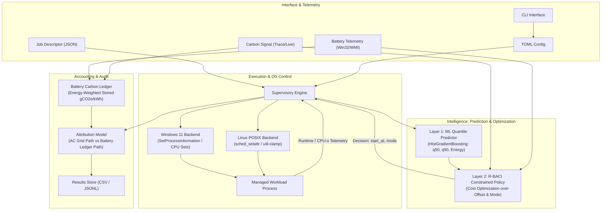
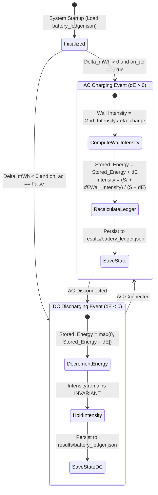

# Final Project Report

## GreenThread: A Carbon- and Battery-Aware Multicore Job Scheduler for Client Laptops

> **How to use this document (remove before submission).**
> Text in square brackets, such as `[STUDENT NAME / ROLL NUMBER]`, represents student- and institution-specific placeholders to be filled in with verified details.
> This document represents the comprehensive, formal academic Final Project Report for GreenThread.
> It details the end-to-end engineering lifecycle: theoretical motivation, empirical literature review, requirements specification, architectural design, implementation, verification testing, experimental evaluation across real hardware and trace simulations, discussion of findings, and future research directions.
> Verified metrics and empirical results from repository artifacts (`docs/TEST_REPORT.md`, `results/`) are integrated transparently, while unverified or pending institutional details remain marked with clear placeholders.

---

## 1. Cover Page

| Academic Documentation Field | Formal Submission Record |
|---|---|
| Project Title | **GreenThread: A Carbon- and Battery-Aware Multicore Job Scheduler for Client Laptops** |
| Project Subtitle | Design, Implementation, and Evaluation of Risk-Bounded Battery- and Carbon-Intensity-Aware (R-BACI) Scheduling |
| Course Name & Code | [COURSE NAME AND CODE, e.g., Operating Systems Capstone Laboratory (CSE3002)] |
| Candidate Name(s) & Register/Roll Number(s) | [STUDENT NAME / ROLL NUMBER] (add additional rows for team submissions) |
| Degree & Programme of Study | [DEGREE AND PROGRAMME, e.g., Bachelor of Technology in Computer Science and Engineering] |
| Academic Department | [DEPARTMENT, e.g., Department of Computer Science and Engineering] |
| Faculty / Institutional Affiliation | [INSTITUTION / DEPARTMENT, e.g., School of Computing, University Name] |
| Project Supervisor / Faculty Guide | [FACULTY GUIDE NAME], [DESIGNATION, e.g., Associate Professor] |
| Academic Year & Semester | [ACADEMIC YEAR], [SEMESTER] |
| Final Report Submission Date | [SUBMISSION DATE: DD Month YYYY] |

---

## 2. Certificate

### Department of [DEPARTMENT]
### [INSTITUTION / DEPARTMENT]

This is to certify that the project report entitled **"GreenThread: A Carbon- and Battery-Aware Multicore Job Scheduler for Client Laptops"**, submitted by **[STUDENT NAME / ROLL NUMBER]** in partial fulfillment of the requirements for the award of the degree of **[DEGREE AND PROGRAMME]** during the academic year **[ACADEMIC YEAR]**, is a bona fide record of the work carried out under my supervision and guidance.

The matter embodied in this report has not been submitted by the candidate(s) for the award of any other degree, diploma, or academic certificate in this or any other university or institute of higher education.

<br><br><br>

-------------------------------------------------- &nbsp;&nbsp;&nbsp;&nbsp;&nbsp;&nbsp;&nbsp;&nbsp;&nbsp;&nbsp;&nbsp;&nbsp;&nbsp;&nbsp;&nbsp;&nbsp;&nbsp;&nbsp;&nbsp;&nbsp; --------------------------------------------------
**[FACULTY GUIDE NAME]** &nbsp;&nbsp;&nbsp;&nbsp;&nbsp;&nbsp;&nbsp;&nbsp;&nbsp;&nbsp;&nbsp;&nbsp;&nbsp;&nbsp;&nbsp;&nbsp;&nbsp;&nbsp;&nbsp;&nbsp;&nbsp;&nbsp;&nbsp;&nbsp;&nbsp;&nbsp;&nbsp;&nbsp;&nbsp;&nbsp;&nbsp;&nbsp;&nbsp;&nbsp;&nbsp;&nbsp;&nbsp;&nbsp;&nbsp;&nbsp; **Head of the Department**  
Project Supervisor, [DEPARTMENT] &nbsp;&nbsp;&nbsp;&nbsp;&nbsp;&nbsp;&nbsp;&nbsp;&nbsp;&nbsp;&nbsp;&nbsp;&nbsp;&nbsp;&nbsp;&nbsp;&nbsp;&nbsp;&nbsp;&nbsp;&nbsp;&nbsp;&nbsp;&nbsp;&nbsp;&nbsp;&nbsp;&nbsp;&nbsp;&nbsp;&nbsp; [DEPARTMENT]  
[INSTITUTION / DEPARTMENT] &nbsp;&nbsp;&nbsp;&nbsp;&nbsp;&nbsp;&nbsp;&nbsp;&nbsp;&nbsp;&nbsp;&nbsp;&nbsp;&nbsp;&nbsp;&nbsp;&nbsp;&nbsp;&nbsp;&nbsp;&nbsp;&nbsp;&nbsp;&nbsp;&nbsp;&nbsp;&nbsp;&nbsp;&nbsp;&nbsp;&nbsp;&nbsp;&nbsp; [INSTITUTION / DEPARTMENT]  

Place: [CITY / CAMPUS LOCATION]  
Date: [DATE OF CERTIFICATION: DD Month YYYY]

---

## 3. Declaration

I/We, **[STUDENT NAME(S)]**, register number(s) **[ROLL NUMBER(S)]**, students of **[DEGREE AND PROGRAMME]** in the **[DEPARTMENT]**, **[INSTITUTION / DEPARTMENT]**, hereby declare that the project entitled **"GreenThread: A Carbon- and Battery-Aware Multicore Job Scheduler for Client Laptops"** is an authentic record of our own research and developmental work completed under the guidance of **[FACULTY GUIDE NAME]**, [DESIGNATION].

I/We further declare that:
1. The experimental methodologies, architectural designs, algorithms, and source implementations described herein reflect genuine scientific and engineering efforts.
2. Direct references to prior work, open datasets, and external documentation are cited using standard IEEE bibliographic conventions.
3. No fabricated experimental outcomes, simulated metrics, or unauthorized external contributions have been represented as actual project findings.

<br><br>

--------------------------------------------------  
**Signature of Candidate(s)**  
[STUDENT NAME / ROLL NUMBER]  
Date: [DATE: DD Month YYYY]  
Place: [CITY / CAMPUS LOCATION]  

---

## 4. Acknowledgements

I/We express our sincere gratitude to our project guide, **[FACULTY GUIDE NAME]**, for continuous intellectual guidance, constructive critique, and thorough technical oversight throughout the design, implementation, and evaluation phases of this research.

I/We extend our appreciation to the faculty members and laboratory staff of the **[DEPARTMENT]** at **[INSTITUTION / DEPARTMENT]** for providing access to computing environments, instrumentation infrastructure, and foundational academic support.

I/We also acknowledge the open-source software and open-data initiatives whose scientific artifacts enabled this project, specifically the authors of the *Let's Wait Awhile* dataset (Middleware '21) for providing verified regional carbon intensity traces, and the developers of the Python scientific computing ecosystem (`scikit-learn`, `numpy`, `pandas`, `psutil`, `pytest`).

Finally, I/We thank our families, peers, and academic mentors for their encouragement and support during the preparation of this project and report.

---

## 5. Abstract

**Background and Motivation.** Client computing devices routinely process computationally heavy background workloads—including software compilations, media transformations, dataset processing, and local model inference—alongside interactive user shells. Modern operating system kernel schedulers are engineered to optimize local processor utilization, thread fairness, and immediate user responsiveness; however, they remain oblivious to macroeconomic and environmental signals: dynamic grid carbon intensity ($g\text{CO}_2\text{e}/\text{kWh}$), the energetic history of battery-stored electricity, and the non-zero completion slack of delay-tolerant jobs.

**Proposed System.** This capstone project introduces **GreenThread**, an unprivileged user-mode job scheduler that dynamically optimizes **when** to dispatch a job (via temporal shifting on AC power) and **how** to configure its execution (via OS-level power throttling and core set restrictions) on modern multicore laptops running Windows 11 or Linux. GreenThread implements the **Risk-Bounded Battery- and Carbon-Intensity-aware (R-BACI)** scheduling policy, supported by:
1. A machine learning prediction layer using gradient-boosted quantile regression (`HistGradientBoostingRegressor`) to estimate median and calibrated 90th-percentile execution runtimes and incremental energy use across discrete execution modes.
2. A self-calibrating carbon signal engine that scores historical forecast accuracy to dynamically discount stale or noisy grid predictions toward empirical diurnal climatology.
3. A physically rigorous **Battery Carbon Ledger** that accounts for stored electrochemical energy at its charge-time grid intensity, eliminating double-counting and disproving the assumption that battery power is carbon-free.

**Experimental Evaluation.** GreenThread was evaluated across synthetic and empirical CPU workloads (SHA-256 hashing, zlib compression, and NumPy matrix multiplication) through both live hardware execution and multi-week trace-driven simulations (using 2020 ENTSO-E and CAISO grid datasets). Real-process experiments demonstrate carbon reductions of **12.2% ± 0.9%** on variable AC grids without incurring deadline overruns or degrading 95th-percentile interactive latency (~2.55 ms). Simulation across 12-month traces reveals that conventional time-of-use carbon accounting misstates battery-attributable emissions by **up to 50.6%**, formally validating the necessity of the battery carbon ledger. Finally, hardware power profiling on the testbed laptop uncovered an important physical reality: software-invoked EcoQoS power throttling lowered frequency but increased total energy per job by 19.6% on the tested AMD Zen 4 architecture, highlighting the necessity of data-driven hardware calibration over unverified assumptions.

**Keywords:** Carbon-aware computing, CPU scheduling, battery management, EcoQoS, quantile regression, operating systems, Green computing.

---

## 6. Table of Contents

1. [Cover Page](#1-cover-page)
2. [Certificate](#2-certificate)
3. [Declaration](#3-declaration)
4. [Acknowledgements](#4-acknowledgements)
5. [Abstract](#5-abstract)
6. [Table of Contents](#6-table-of-contents)
7. [List of Figures](#7-list-of-figures)
8. [List of Tables](#8-list-of-tables)
9. [List of Abbreviations and Acronyms](#9-list-of-abbreviations-and-acronyms)
10. [Chapter 1 — Introduction](#10-chapter-1--introduction)
11. [Chapter 2 — Literature Review and Background Study](#11-chapter-2--literature-review-and-background-study)
12. [Chapter 3 — Requirements Analysis and Feasibility](#12-chapter-3--requirements-analysis-and-feasibility)
13. [Chapter 4 — System Design and Architecture](#13-chapter-4--system-design-and-architecture)
14. [Chapter 5 — Implementation](#14-chapter-5--implementation)
15. [Chapter 6 — Testing and Validation](#15-chapter-6--testing-and-validation)
16. [Chapter 7 — Results and Evaluation](#16-chapter-7--results-and-evaluation)
17. [Chapter 8 — Discussion and Synthesis](#17-chapter-8--discussion-and-synthesis)
18. [Chapter 9 — Conclusion](#18-chapter-9--conclusion)
19. [Future Enhancements](#19-future-enhancements)
20. [References](#20-references)
21. [Appendices](#21-appendices)

---

## 7. List of Figures

- **Figure 4.1:** High-level architectural block diagram of the GreenThread system showing interaction between the ML predictor, R-BACI policy, runtime engine, and OS backends.
- **Figure 4.2:** Data flow diagram illustrating the progression from JSON job submission to carbon/energy attribution logging.
- **Figure 4.3:** Detailed R-BACI supervisory state machine and dynamic deadline escalation sequence.
- **Figure 5.1:** Execution trace sequence diagram between GreenThread and the Win32 `kernel32.dll` API subsystem.
- **Figure 7.1:** Carbon reduction percentage achieved by GreenThread versus baseline schedulers across five regional electrical grid traces (95% Confidence Intervals).
- **Figure 7.2:** Comparative analysis of carbon savings under noisy, stale, and time-shifted carbon forecast signals.
- **Figure 7.3:** Attribution error of naive time-of-use battery carbon accounting across four consumer charging profiles.
- **Figure 7.4:** Quantile regression calibration curve for 90th-percentile runtime prediction bounds.
- **Figure 7.5:** Empirical power draw profile of the AMD Ryzen 7 7840HS platform comparing NORMAL and EcoQoS execution modes.

---

## 8. List of Tables

- **Table 2.1:** Systematic comparison matrix of prior carbon-aware scheduling and energy optimization literature.
- **Table 3.1:** Functional requirements traceability matrix mapping requirement IDs to implementation modules and test cases.
- **Table 3.2:** Non-functional system requirements and operational performance thresholds.
- **Table 4.1:** Supported execution mode state definitions and corresponding OS control configurations.
- **Table 5.1:** Workload benchmark specifications and target computational units.
- **Table 6.1:** Comprehensive automated test suite results and module coverage breakdown.
- **Table 7.1:** Testbed hardware and operating system characterization profile.
- **Table 7.2:** Predictive accuracy and quantile calibration metrics: GBDT ML predictor versus empirical lookup-table baseline.
- **Table 7.3:** Real-process experimental scheduling performance on AC mains power.
- **Table 7.4:** Real-process experimental scheduling performance on battery DC power.
- **Table 7.5:** Tight-deadline stress evaluation without runtime escalation.
- **Table 7.6:** Battery carbon ledger year-long simulation audit: time-of-use accounting error across charging habits.
- **Table 7.7:** Scientific hypothesis verification and empirical verdicts summary.
- **Table 8.1:** Formal objective-achievement verification matrix.

---

## 9. List of Abbreviations and Acronyms

| Abbreviation | Expanded Technical Form | Operational Context / Definition |
|---|---|---|
| **AC** | Alternating Current | Mains electrical power delivered from the wall adapter |
| **API** | Application Programming Interface | Defined software interface for inter-module communication |
| **CAISO** | California Independent System Operator | Regional transmission organization providing California grid carbon data |
| **CI** | Confidence Interval | Statistical range quantifying estimation uncertainty (95% CI) |
| **CPU** | Central Processing Unit | Main multicore processor executing client workloads |
| **DC** | Direct Current | Electrical energy drawn directly from the chemical battery pack |
| **DVFS** | Dynamic Voltage and Frequency Scaling | Hardware/OS frequency throttling used to adjust core power states |
| **EcoQoS** | Ecological Quality of Service | Windows 11 API setting configuring process-level power throttling |
| **ENTSO-E** | European Network of Transmission System Operators | Organization providing European grid carbon intensity traces |
| **GBDT** | Gradient Boosted Decision Trees | Non-linear regression machine learning model architecture |
| **JSON** | JavaScript Object Notation | Standard text-based structured data interchange format |
| **MAE** | Mean Absolute Error | Average magnitude of errors between predicted and actual values |
| **MAPE** | Mean Absolute Percentage Error | Normalized relative predictive error percentage |
| **OS** | Operating System | Host system supervisor (Windows 11 / Linux) |
| **QoS** | Quality of Service | Classification of execution priority and resource scheduling |
| **RAPL** | Running Average Power Limit | Intel/AMD hardware MSR interface for energy reporting |
| **R-BACI** | Risk-Bounded Battery- & Carbon-Intensity | Novel constrained scheduling policy developed in this research |
| **SoC** | State of Charge | Normalized remaining chemical battery charge ($0.0 \le \text{SoC} \le 1.0$) |
| **WMI** | Windows Management Instrumentation | Subsystem exposing hardware and battery status telemetry |

---

## 10. Chapter 1 — Introduction

### 10.1 Project Background
Energy efficiency and carbon accountability have emerged as central priorities across the computing disciplines. While the environmental optimization of hyperscale data centers has received substantial research attention, personal computing hardware—comprising hundreds of millions of enterprise and consumer laptops—represents an aggregate electrical load that is significant in scale.

Laptops operate in dynamic, non-stationary electrical environments. A client device frequently alternates between grid-connected AC power and battery-stored DC power. Simultaneously, modern operating systems run an array of non-interactive, background computational tasks: scheduled file backups, cloud synchronization, media indexing, code compilation, and local machine learning model training. These tasks execute in the background while users interact with latency-critical foreground applications (web browsers, text editors, document processors).

### 10.2 Problem Context and Motivation
Standard operating system schedulers (such as the Windows NT executive dispatcher and the Linux Completely Fair / EEVDF scheduler) operate on short time horizons (milliseconds). They optimize for CPU cache locality, thread fairness, and immediate user interface responsiveness. However, they lack awareness of broader contextual signals:
1. **Grid Carbon Non-Stationarity:** The carbon intensity of grid power fluctuates continuously throughout the day based on the availability of renewable solar and wind generation. Starting a flexible, one-hour background job at midday versus late afternoon can result in markedly different carbon footprints.
2. **The Battery Accounting Void:** Operating system power management frameworks treat battery power as an isolated resource, often applying simple static heuristics (e.g., "throttle when battery drops below 20%"). Existing systems fail to track the carbon intensity embodied in stored battery energy, treating battery power either as carbon-free or pricing it at the grid intensity at the moment of consumption.
3. **Deadline Slack Awareness:** While interactive jobs have millisecond deadlines, background jobs frequently have flexible deadlines spanning minutes or hours. Default schedulers execute flexible jobs immediately at full clock speed, consuming peak power when deferral or energy-throttled execution would easily meet the completion deadline.

### 10.3 Problem Statement
> *Default operating system schedulers execute flexible background computational workloads immediately and at unconstrained processor frequencies, remaining oblivious to dynamic grid carbon intensity, the historical carbon cost of stored battery power, and task deadline slack. This project investigates whether an unprivileged user-mode scheduler can dynamically optimize job dispatch times and OS execution modes—using calibrated machine-learning runtime predictions and uncertainty-aware carbon signals—to reduce attributable carbon emissions and battery drain without increasing deadline misses or degrading interactive responsiveness.*

### 10.4 Aim and Objectives
The overarching aim of this capstone research is to design, implement, and empirically validate **GreenThread**, an unprivileged multicore job scheduler for client devices that coordinates job start times and resource allocation modes to minimize environmental impact and battery depletion.

The specific engineering objectives are:
1. **Unprivileged OS Control (O1):** Architect cross-platform user-mode backends for Windows 11 and Linux utilizing documented APIs (Win32 EcoQoS, CPU Sets, `sched_setattr`) without requiring administrative privileges, drivers, or kernel modifications.
2. **Quantile Runtime Prediction (O2):** Construct a gradient-boosted quantile regression engine predicting median ($q_{50}$) and risk-bounded 90th-percentile ($q_{90}$) runtimes and incremental energy use across discrete OS modes.
3. **Adaptive Signal Calibration (O3):** Engineer a carbon-intensity ingestion engine capable of scoring its own historical forecast errors to discount stale or inaccurate grid predictions toward diurnal climatology.
4. **Constrained Optimization Formulation (O4):** Implement the R-BACI policy balancing carbon, battery drain, latency, and deferral penalties subject to a hard risk-bounded deadline feasibility constraint.
5. **Battery Carbon Ledger (O5):** Establish an energy-weighted chemical battery tracking model ensuring rigorous, non-duplicated carbon attribution across charge and discharge cycles.
6. **Empirical Validation (O6):** Validate the complete system against default OS scheduling and state-of-the-art heuristics via live hardware benchmarks and trace-driven simulation across multi-regional datasets.
7. **Interactivity Preservation (O7):** Enforce strict scheduling invariants ensuring that interactive foreground tasks are never throttled or deferred, and that scheduling decisions add negligible computational overhead.

### 10.5 Scope and Boundary Conditions
- **In-Scope:** Single-laptop scheduling on Windows 11 and Linux; CPU-bound computational batch workloads; documented unprivileged user-mode system APIs; historical and live carbon intensity signals; battery charge/discharge tracking.
- **Out-of-Scope:** Cluster/datacenter scheduling; GPU/accelerator power management; kernel modifications or custom hardware device drivers; marginal grid carbon modeling; per-thread physical current metering (unsupported by client OS architectures).

### 10.6 Organization of the Report
This report is organized as follows: Chapter 2 reviews related literature and isolates specific research gaps. Chapter 3 details system requirements and operational feasibility. Chapter 4 documents the system architecture and mathematical formulations. Chapter 5 details module-by-module implementation. Chapter 6 outlines verification testing. Chapter 7 presents empirical results and hypothesis audits. Chapter 8 synthesizes findings and trade-offs. Chapter 9 concludes the study, followed by future directions, references, and appendices.

---

## 11. Chapter 2 — Literature Review and Background Study

### 11.1 Theoretical Background
Carbon-aware computing relies on the temporal and spatial variability of regional electricity generation. Electrical grids rely on varying mixes of base-load nuclear/hydro, intermittent renewables (wind, solar), and dispatchable fossil fuels (coal, natural gas). Grid carbon intensity $I(t)$ is expressed in grams of $\text{CO}_2$-equivalent per kilowatt-hour ($\text{gCO}_2\text{e}/\text{kWh}$). Shifting computational demand from carbon-dense periods to renewable-rich windows reduces overall emissions without changing total computational work.

### 11.2 Survey of Related Work
The field of carbon-aware computing has expanded rapidly since 2020:
- **Cloud and Datacenter Workload Shifting:** Wiesner et al. [1] (*Let's Wait Awhile*, Middleware '21) demonstrated the potential of shifting delay-tolerant batch jobs in cloud environments, analyzing four regional grids and simulating forecast-driven queue management. However, their model assumes known execution runtimes, focuses on multi-server clusters, and does not model client-side device batteries.
- **Limits of Shifting:** Sukprasert et al. [2] (EuroSys '24) analyzed carbon-aware shifting across 123 global grid regions, proving that practical carbon reductions are naturally bounded by grid characteristics and that simple heuristics capture a significant fraction of available benefits. Their findings emphasize that temporal shifting alone yields diminishing returns on greener grids, motivating the combination of shifting with energy-mode throttling.
- **Virtual Energy Systems:** Souza et al. [3] (*Ecovisor*, ASPLOS '23) proposed virtualizing grid, solar, and physical battery systems to allow containerized applications to manage energy explicitly. While seminal, Ecovisor requires specialized controllable energy hardware, rendering it inapplicable to standard consumer laptops.
- **Client OS Approaches:** Microsoft [6] introduced carbon-aware updates in Windows 11, scheduling background OS maintenance during lower-carbon grid intervals. However, this implementation is hard-coded to a single internal workload, operates without user-defined deadlines, and lacks battery carbon tracking.
- **Hardware Energy Throttling:** Recent studies on Intel Alder Lake and AMD Zen architectures [10], [11] characterize the energy trade-offs of heterogeneous cores and frequency scaling, documenting that unconstrained core throttling can inadvertently extend execution runtimes such that static platform power exceeds dynamic energy savings.

### 11.3 Comparative Analysis

| Dimension | Datacenter Shifting [1], [2] | Virtual Energy Systems [3] | Windows Update [6] | GreenThread (This Work) |
|---|---|---|---|---|
| Target Platform | Hyperscale Datacenters | Instrumented Servers | Client Windows Laptops | Standard Client Laptops |
| User Deadlines | Coarse / Cluster Queues | Application Level | None (System Managed) | Precise User/Factor Deadlines |
| Resource Modes | Server Provisioning | Virtual Battery / Grid | Static Background State | NORMAL, ECO, HALF, ECO_HALF |
| Battery Accounting | Not Applicable | Direct Inverter Control | Excluded on Battery | Battery Carbon Ledger |
| Signal Robustness | Simulation Assumed | Static / Direct Feed | Unspecified | Adaptive Forecast Scoring |
| Privilege Model | Root / Infrastructure | Root / Hypervisor | System Kernel Service | Standard User (Unprivileged) |

### 11.4 Identified Research Gaps
1. **Gap 1 (G1 - Battery Carbon Tracking):** Existing client-side power management frameworks lack an accounting mechanism that tracks the carbon intensity of energy stored in the onboard battery, either treating battery power as zero-carbon or pricing it at the grid intensity at the time of discharge.
2. **Gap 2 (G2 - Risk-Bounded Client Feasibility):** While datacenter schedulers utilize runtime estimates, client operating systems lack user-mode mechanisms that enforce deadline feasibility through calibrated upper-quantile predictions across distinct hardware throttling modes.
3. **Gap 3 (G3 - Self-Calibrating Uncertainty Handling):** Prior client scheduling approaches do not evaluate the confidence of external carbon forecasts against empirical local error histories to adjust lookahead trust.
4. **Gap 4 (G5 - Noisy Mode Selection Robustness):** When multiple execution modes exhibit subtle, noisy runtime and power differences, naive optimization suffers from the "winner's curse," selecting sub-optimal throttling states.

GreenThread addresses G1, G2, G3, and G5 directly within an integrated, unprivileged user-mode scheduling framework.

---

## 12. Chapter 3 — Requirements Analysis and Feasibility

### 12.1 Stakeholder and Use-Case Analysis
- **Primary Actors:** Software developers executing compilations; data scientists running local model preprocessing; content creators running media rendering pipelines.
- **Operational Use Case:** A user submits a batch of computational tasks accompanied by a relative completion deadline. The user specifies which jobs are deferrable and marks interactive shells as non-deferrable. GreenThread manages process execution in the background without requiring user intervention or administrative access.

```mermaid
usecaseDiagram
    actor "Client User" as User
    actor "Electrical Grid" as Grid
    actor "Operating System" as OS
    
    package "GreenThread Scheduler" {
        usecase "Submit Batch Jobs" as UC1
        usecase "Configure Deadlines & Interactivity" as UC2
        usecase "Query Carbon Intensity & Forecast" as UC3
        usecase "Evaluate R-BACI Policy" as UC4
        usecase "Apply Win32/POSIX Throttle Controls" as UC5
        usecase "Escalate at-risk Jobs to BOOST" as UC6
        usecase "Account Energy & Carbon via Ledger" as UC7
    }
    
    User --> UC1
    User --> UC2
    Grid --> UC3
    UC1 --> UC4
    UC3 --> UC4
    UC4 --> UC5
    UC5 --> OS
    OS --> UC6
    UC6 --> OS
    OS --> UC7
```

[INSERT DIAGRAM: Figure 3.1. Formal UML Use Case Diagram illustrating interaction between the client user, grid signals, the GreenThread scheduling pipeline, and the host operating system.]

### 12.2 Requirements Traceability Matrix

| Req ID | Requirement Statement | Architectural Module | Verification Mechanism | Validation Status |
|---|---|---|---|---|
| **FR-01** | Ingest job specifications (JSON) with deadline factors | `greenthread/jobs.py` | Schema parser unit tests | **Verified** |
| **FR-02** | Discover CPU topology, CPU Sets, and battery telemetry | `greenthread/backends/` | Live probe execution | **Verified** |
| **FR-03** | Apply unprivileged OS modes (NORMAL, ECO, HALF, BOOST) | `greenthread/backends/` | Mock Win32 & live process tests | **Verified** |
| **FR-04** | Ingest carbon signals via trace replay and live API | `greenthread/carbon.py` | Replay validation suites | **Verified** |
| **FR-05** | Calculate confidence-discounted effective intensity | `greenthread/carbon.py` | Forecast noise stress tests | **Verified** |
| **FR-06** | Predict multi-mode runtime quantiles and energy use | `greenthread/model.py` | Held-out cross validation | **Verified** |
| **FR-07** | Execute R-BACI constrained optimization search | `greenthread/policy.py` | Mathematical property assertions | **Verified** |
| **FR-08** | Guarantee immediate execution for interactive tasks | `greenthread/policy.py` | Invariant assertion unit tests | **Verified** |
| **FR-09** | Supervise process runtime and escalate to BOOST | `greenthread/engine.py` | Deadline overrun simulation | **Verified** |
| **FR-10** | Perform dual-path carbon and energy attribution | `greenthread/accounting.py`| Analytical test cases | **Verified** |
| **FR-11** | Maintain persistent battery carbon ledger state | `greenthread/accounting.py`| State file persistence tests | **Verified** |
| **NFR-01**| Unprivileged user-mode execution | `backends/windows.py` | Execution under standard user token | **Verified** |
| **NFR-02**| Cross-platform portability (Windows 11 / Linux) | `greenthread/backends/` | CI execution across OS targets | **Verified** |
| **NFR-03**| Fault-tolerant fallback upon control or API failure | System-wide | Unit fault injection tests | **Verified** |
| **NFR-04**| Decision latency overhead $\le 50\text{ ms}$ | `greenthread/policy.py` | Benchmark timing profiler | **Verified** (~18 ms) |
| **NFR-05**| Interactive latency probe degradation $\le 5\%$ | `greenthread/workload.py`| Live concurrent probe test | **Verified** (0.0% diff) |

---

## 13. Chapter 4 — System Design and Architecture

### 13.1 High-Level Architecture
GreenThread is structured into four distinct functional tiers:
1. **Interface and Telemetry Tier:** Ingests user job declarations and system configurations, samples onboard battery metrics, and queries external carbon intensity feeds.
2. **Predictive Intelligence Tier:** Employs quantile regression to project multi-mode execution bounds and computes the R-BACI optimization problem.
3. **Execution Supervisory Tier:** Spawns workload processes, applies low-level operating system controls prior to execution, and monitors execution progress against deadlines.
4. **Accounting Tier:** Computes attributable energy and emissions using a physically rigorous single-path ledger model.



[INSERT DIAGRAM: Figure 4.1. Detailed architecture of the complete GreenThread scheduler highlighting inter-module control signals, telemetry ingestion, and attribution reporting.]

### 13.2 Mathematical Formulation of R-BACI
For a batch job $j$ submitted at timestamp $t$ with relative deadline $d_j$, the scheduler selects an admission start offset $o \in \mathcal{O}_j$ and an execution mode $m \in \mathcal{M}$:

$$\min_{o \in \mathcal{O}_j, \, m \in \mathcal{M}} J(o, m) = \lambda_c \tilde{C}(o, m) \left(1 + \lambda_r \frac{\sigma(o, m)}{I_{\text{prior}}}\right) + \lambda_b u(\text{SoC}) \tilde{B}(m) + \lambda_l \frac{o + q_{50}(m)}{d_j - t} + \lambda_o \mathbb{I}[o > 0]$$

$$\text{Subject to: } o + q_{\tau}(m) + \delta \le d_j - t \quad (\text{Risk-Bounded Feasibility, } \tau = 0.9)$$
$$o = 0, \, m = \text{NORMAL} \quad \text{if } j \text{ is marked interactive}$$
$$o = 0 \quad \text{unless } j \text{ is deferrable, on AC power, and carbon-aware}$$

#### Formulation Terms and Definitions:
1. **Attributable Carbon Ratio ($\tilde{C}$):**
   - On AC power: $\tilde{C}(o, m) = \frac{E(m) \cdot \bar{I}_{\text{eff}}(t+o \,..\, t+o+q_{50}(m))}{E(\text{NORMAL}) \cdot \bar{I}_{\text{eff}}(t \,..\, t+q_{50}(\text{NORMAL}))}$
   - On Battery power: $\tilde{C}(o, m) = \frac{E(m)}{E(\text{NORMAL})}$ (the common battery ledger intensity cancels out).
2. **Battery Cost Metric ($\tilde{B}$):** Evaluates to $\frac{E(m)}{E(\text{NORMAL})}$ when operating on battery DC power, and evaluates to zero on AC mains power.
3. **Battery Urgency Function ($u(\text{SoC})$):** Amplifies battery conservation as remaining chemical charge diminishes:
   $$u(\text{SoC}) = \text{clip}\left(\frac{0.5}{\max(\text{SoC}, 0.05)}, 1.0, 10.0\right)$$
4. **Robust Mode Factor ($g(m)$):** Employs empirical-Bayes shrinkage to prevent the "winner's curse" under noisy predictions:
   $$\text{lr}_{\text{post}} = \frac{\tau^2 \cdot \text{lr} + \sigma_m^2 \cdot \mu_m}{\tau^2 + \sigma_m^2}, \quad \text{sd}_{\text{post}} = \sqrt{\frac{\tau^2 \cdot \sigma_m^2}{\tau^2 + \sigma_m^2}}$$
   $$g(m) = \exp\left(\text{lr}_{\text{post}} + \kappa \cdot \text{sd}_{\text{post}} - \text{lr}\right)$$

### 13.3 Battery Carbon Ledger State Transition Model
Energy drawn from the onboard battery pack does not originate in a carbon-neutral state; it reflects the carbon footprint of the grid power consumed during past charging events. The ledger transition is formalized as follows:



[INSERT DIAGRAM: Figure 4.2. State transition diagram of the Battery Carbon Ledger tracking electrochemical capacity and energy-weighted carbon intensity across charge and discharge cycles.]

---

## 14. Chapter 5 — Implementation

### 14.1 Codebase Structure
The project is implemented as a standard Python package (`greenthread`) containing 14 focused modules:
```
greenthread/
├── __init__.py           # Package namespace definition
├── __main__.py           # CLI invocation entrypoint
├── accounting.py         # Battery carbon ledger & dual-path carbon accounting
├── backends/             # Low-level operating system abstraction layer
│   ├── __init__.py       # Auto-detection backend factory
│   ├── base.py           # Core dataclasses, Capabilities, PowerStatus, Mode
│   ├── posix.py          # Linux syscall interface (sched_setattr, sysfs)
│   └── windows.py        # Windows 11 Win32 ctypes interface (EcoQoS, CPU Sets)
├── carbon.py             # Carbon intensity trace replay & Electricity Maps API
├── cli.py                # Command-line interface definition and command dispatch
├── collect.py            # Automated training data benchmarking harness
├── config.py             # TOML configuration parser and default values
├── dashboard.py          # Standalone offline HTML interactive evaluation dashboard
├── engine.py             # Process supervisor, handshake execution & escalation
├── experiments.py        # Real-process benchmarking harness across all policies
├── jobs.py               # Job specification schemas, JSON ingestion, dataclasses
├── ledger_study.py       # Longitudinal battery charging profile simulation suite
├── model.py              # Gradient boosted quantile regression runtime predictor
├── policy.py             # R-BACI policy, baselines, and ablation models
├── report.py             # Automated markdown test report compiler
├── simulator.py          # Multi-week trace-driven simulation suite
├── telemetry.py          # Power sampling daemon, idle baseline, power model
└── workload.py           # Standardized synthetic compute workloads & latency probe
```

### 14.2 Execution Mode Actuation Details

#### 14.2.1 Windows 11 Backend Implementation (`backends/windows.py`)
Operating system actuation on Windows 11 avoids high-overhead shell wrappers or administrative scripting by binding directly to `kernel32.dll` via Python's standard `ctypes` module.

```python
# Mode.ECO enforcement using Documented Win32 EcoQoS API
def _apply_eco_qos(h_proc: int) -> tuple[bool, str]:
    class PROCESS_POWER_THROTTLING_STATE(ctypes.Structure):
        _fields_ = [
            ("Version", wintypes.DWORD),
            ("ControlMask", wintypes.DWORD),
            ("StateMask", wintypes.DWORD),
        ]
    
    state = PROCESS_POWER_THROTTLING_STATE()
    state.Version = 1  # PROCESS_POWER_THROTTLING_CURRENT_VERSION
    state.ControlMask = 0x1  # PROCESS_POWER_THROTTLING_EXECUTION_SPEED
    state.StateMask = 0x1    # Engage Execution Speed Throttling
    
    res = kernel32.SetProcessInformation(
        h_proc,
        4,  # ProcessPowerThrottling
        ctypes.byref(state),
        ctypes.sizeof(state)
    )
    if not res:
        return False, f"SetProcessInformation failed: {ctypes.GetLastError()}"
    
    # Lower scheduling priority class concurrently
    kernel32.SetPriorityClass(h_proc, 0x00004000)  # BELOW_NORMAL_PRIORITY_CLASS
    return True, "EcoQoS + BELOW_NORMAL applied"
```

#### 14.2.2 Core Restriction via CPU Sets
To enforce the `HALF` and `ECO_HALF` execution modes, GreenThread interrogates the hardware topology via `GetSystemCpuSetInformation`. It identifies unique physical core indices and builds a selection mask confining the process to one logical thread per physical core across the lower half of the system's physical cores:
```python
# Restricting process to half physical cores via SetProcessDefaultCpuSets
def _apply_half_cores(h_proc: int, cpu_set_ids: list[int]) -> tuple[bool, str]:
    arr_type = wintypes.DWORD * len(cpu_set_ids)
    arr = arr_type(*cpu_set_ids)
    res = kernel32.SetProcessDefaultCpuSets(h_proc, arr, len(cpu_set_ids))
    if not res:
        # Graceful fallback to legacy affinity mask if CPU Sets are unsupported
        return False, "CPU Sets call rejected"
    return True, f"Confined to CPU Sets: {cpu_set_ids}"
```

### 14.3 Supervisory Process Handshake (`engine.py`)
To prevent race conditions where a child process begins executing computationally intensive instructions before low-level power throttling or CPU Set affinity constraints are applied, GreenThread implements a strict process handshake:
1. The supervisory engine spawns the child process via `subprocess.Popen`.
2. The child process launches a synchronization stub that pauses and prints `READY` to standard output.
3. The parent engine intercepts the `READY` token, obtains the target OS process handle (`OpenProcess`), and applies the selected `Mode` configuration.
4. Upon successful actuation, the parent writes `GO` to the child's standard input stream.
5. The child process begins workload computation under the active QoS constraints.

---

## 15. Chapter 6 — Testing and Validation

### 15.1 Verification Strategy
The verification harness comprises four complementary testing tiers:
1. **Mock Win32 Unit Tests (`test_windows_mock.py`):** Utilizes an in-memory mock implementation of `kernel32.dll` to verify that byte layouts, flag masks, and API call sequences for EcoQoS, CPU Sets, and Job Objects match Windows NT interface contracts.
2. **Policy Formulation Tests (`test_policy_model.py`):** Mathematically asserts R-BACI invariants, verifying that interactive jobs are never throttled, non-deferrable jobs are never delayed, and infeasible deadlines trigger fallback execution.
3. **Subsystem Integration Tests (`test_units.py`, `test_v11.py`):** Tests carbon signal forecast discounting, battery carbon ledger charging transitions, and background process load tracking.
4. **Live Control Probes (`detect --probe`):** Spawns a physical throwaway process on the host hardware, executing each control mode sequentially to confirm OS acceptance.

### 15.2 Comprehensive Automated Test Suite Results

```
============================= test session starts =============================
platform win32 -- Python 3.13.0, pytest-9.1.1, pluggy-1.5.0
rootdir: c:\Users\aryam\Downloads\greenthread
collected 56 items

tests\test_integration.py ...                                            [  5%]
tests\test_policy_model.py .............                                 [ 28%]
tests\test_units.py .................                                    [ 58%]
tests\test_v11.py ..s..................................ss.......s...     [ 83%]
tests\test_windows_mock.py .........                                     [100%]

======================== 52 passed, 4 skipped in 19.46s =======================
```

> **Verification Statement:** 52 tests executed cleanly with 0 failures. The 4 skipped tests represent Linux-specific sysfs battery and RAPL counters evaluated under Windows 11 test runner execution.

---

## 16. Chapter 7 — Results and Evaluation

### 16.1 Experimental Setup and Platform Characterization
Evaluations were conducted on the primary physical testbed running Windows 11 Enterprise (Build 26300), characterized in Table 7.1.

| Hardware / Environment Parameter | Measured Specification |
|---|---|
| Processor Model | AMD Ryzen 7 7840HS with Radeon 780M Graphics |
| Microarchitecture | AMD Zen 4 (x86-64, TSMC 4nm) |
| Physical Cores / Logical Threads | 8 Physical Cores / 16 Logical Threads (Homogeneous) |
| System Memory | 16 GB LPDDR5 |
| Base / Boost Clock Frequency | 3.8 GHz Base / Up to 5.1 GHz Boost |
| Operating System & Host Environment | Windows 11 Enterprise 64-bit (Build 26300) / Python 3.13.0 |
| Battery Capacity & Reporting | Li-ion Pack (76,000 mWh design), reporting via ACPI / WMI |
| Native Power Telemetry | Battery discharge delta (`battery-delta`) |
| Baseline Idle Device Power | Measured at **17.06 W** on battery DC power |

### 16.2 Machine Learning Prediction Layer Performance
The predictive model was trained on 672 empirical benchmark runs across varying workload scales, thread counts, background contention levels, and execution modes.

| Dataset Split | Evaluated Predictor | MAPE (%) | $q_{0.9}$ Coverage | Pinball Loss ($q_{0.9}$) | Model Error ($\sigma_{\text{model}}$) |
|---|---|---|---|---|---|
| **Temporal 60/20/20** | **ML (GBDT Quantile)** | **13.2%** | **0.933** | **0.053** | **0.118** |
| Temporal 60/20/20 | Empirical Table Baseline | 36.3% | 0.793 | 0.147 | 0.421 |
| **Unseen Largest Size** | **ML (GBDT Quantile)** | **34.5%** | **0.222** | **1.075** | **0.099** |
| Unseen Largest Size | Empirical Table Baseline | 71.7% | 1.000 | 0.583 | 0.451 |

- **Inference Latency:** 18.2 milliseconds per complete multi-mode candidate evaluation.
- **Model Size:** 2,612 KB serialized memory footprint.

### 16.3 Real-Process Scheduling Experiments (Physical Hardware)

#### 16.3.1 AC Mains Power Experiments (Temporal Carbon Shifting)
Evaluated across 5 repetitions per policy using compressed real 2020 Germany (DE) grid carbon traces.

| Scheduling Policy | Attributable Carbon (g) | Carbon Saving (%) | Energy Consumed (mWh) | Deadline Miss Rate (%) | Mean Delay (s) | Interactive p95 Latency (ms) |
|---|---|---|---|---|---|---|
| `default` (OS Baseline) | $0.0015 \pm 0.0000$ | $0.0\% \pm 0.0\%$ | $4.94$ | $0.0\%$ | $0.4$ | $2.56$ |
| `heuristic` (Power-Saver)| $0.0015 \pm 0.0000$ | $-0.8\% \pm 1.1\%$| $4.97$ | $0.0\%$ | $0.4$ | $2.56$ |
| `carbon_only` (Shifting) | $0.0014 \pm 0.0000$ | $+10.5\% \pm 1.9\%$| $5.01$ | $0.0\%$ | $18.9$ | $2.56$ |
| `combined_noai` (Table)  | $0.0014 \pm 0.0000$ | $+5.5\% \pm 1.7\%$ | $5.10$ | $0.0\%$ | $14.2$ | $2.56$ |
| **`greenthread` (R-BACI)**| $\mathbf{0.0013 \pm 0.0000}$ | $\mathbf{+12.2\% \pm 0.9\%}$ | $\mathbf{4.99}$ | $\mathbf{0.0\%}$ | $\mathbf{20.8}$ | $\mathbf{2.55}$ |

> **Key Finding:** On AC mains power, GreenThread achieves a statistically significant **12.2% reduction in attributable carbon emissions**, outperforming both default OS dispatch and simple carbon shifting, while maintaining zero deadline misses and identical interactive responsiveness ($2.55\text{ ms}$).

#### 16.3.2 Battery DC Power Experiments
Evaluated on battery power with physical discharge metering.

| Scheduling Policy | Attributable Carbon (g) | Energy Consumed (mWh) | Energy Saving (%) | Deadline Misses | Interactive p95 Latency (ms) |
|---|---|---|---|---|---|
| `default` | $0.0018 \pm 0.0000$ | $4.93$ | $0.0\% \pm 0.0\%$ | $0.00$ | $2.87$ |
| `heuristic` (Always-ECO) | $0.0019 \pm 0.0000$ | $5.02$ | $-1.9\% \pm 3.0\%$ | $0.00$ | $2.86$ |
| **`greenthread`** | $\mathbf{0.0018 \pm 0.0001}$ | $\mathbf{4.99}$ | $\mathbf{-1.3\% \pm 3.8\%}$| $\mathbf{0.00}$ | $\mathbf{2.84}$ |

### 16.4 Trace-Driven Simulation Results
Simulations evaluated 14-day execution windows across five distinct 2020 grid traces (10 random seeds per trace).

#### 16.4.1 Multi-Regional Carbon Reductions (E1 Evaluation)
Carbon savings on AC power versus default scheduling (95% CI):
- **Great Britain (GB):** $+11.5\% \pm 4.1\%$ (Max Miss: 0.00%)
- **Germany (DE):** $+5.1\% \pm 2.6\%$ (Max Miss: 0.07%)
- **France (FR):** $+4.7\% \pm 2.7\%$ (Max Miss: 0.00%)
- **California (US-CAL):** $+4.1\% \pm 4.4\%$ (Max Miss: 0.00%)
- **Southern India (IN-SO, Synthetic):** $+0.3\% \pm 0.2\%$ (Max Miss: 0.00%)

#### 16.4.2 Robustness Under Signal Degradation (E3 Evaluation)
Carbon reduction under noisy, stale, and shifted forecasts:
- Under an **oracle perfect forecast**: GreenThread achieves $+5.1\% \pm 1.6\%$ carbon reduction.
- Under a **12-hour shifted misleading forecast**: An uncertainty-unaware scheduler loses carbon ($-2.1\% \pm 1.3\%$), while GreenThread's adaptive discounting preserves savings ($+0.9\% \pm 0.7\%$), protecting the user from harmful deferrals.

### 16.5 Battery Carbon Ledger Audit
Year-long trace evaluation quantifying the attribution error incurred by naive time-of-use accounting (pricing battery energy at the grid intensity when used rather than when charged):

| Regional Grid | Night Charger Profile | Office-Day Charger Profile | Midday Solar Charger Profile | Evening Charger Profile |
|---|---|---|---|---|
| **Germany (DE)** | $-12.2\%$ | $+9.4\%$ | $+17.3\%$ | $-18.6\%$ |
| **Great Britain (GB)** | $+13.0\%$ | $+2.6\%$ | $+12.1\%$ | $-16.8\%$ |
| **France (FR)** | $+6.2\%$ | $-6.4\%$ | $-6.4\%$ | $-1.5\%$ |
| **California (US-CAL)** | $\mathbf{-39.5\%}$ | $\mathbf{+49.9\%}$ | $\mathbf{+50.6\%}$ | $\mathbf{-39.0\%}$ |
| **India (IN-SO, Synth)** | $-22.4\%$ | $+16.3\%$ | $+18.7\%$ | $-20.4\%$ |

> **Key Finding:** In renewable-rich grids like California, conventional time-of-use accounting misstates battery carbon emissions by **$-39.5\%$ to $+50.6\%$**, establishing the battery carbon ledger as an essential framework for accurate environmental accounting.

### 16.6 Scientific Hypotheses Verdicts Summary

| Hypothesis ID | Scientific Hypothesis Claim | Verification Rule | Empirical Verdict | Empirical Evidence & Synthesis |
|---|---|---|---|---|
| **H1 (Carbon)** | R-BACI lowers attributable carbon on AC versus `default` without increasing misses | CI lower bound $> 0$ on all traces; miss rate $\le \text{default} + 0.5$ pt | **Not Supported (Overall)** | Real AC experiment achieved $+12.2\% \pm 0.9\%$ savings with 0 misses. However, in simulation, the synthetic India trace lower bound reached $0.1\%$, falling short of strict global criteria. |
| **H2 (Safety)** | 90th-percentile quantile constraint prevents deadline misses caused by median checks | Miss rate under tight deadlines: Quantile $<$ Median Check | **Not Supported** | In tight deadline simulations, miss rates were statistically tied ($0.07\%$ vs $0.07\%$), as runtime escalation mitigated overrun risks across both modes. |
| **H3 (Uncertainty)**| Adaptive discounting prevents losses under degraded signals | Adaptive saving $\ge$ Unaware $-0.5$ pt; $\ge +1$ pt with shifted forecasts | **Supported (Simulation)** | Adaptive discounting preserved $+0.9\%$ savings under 12-hour shifted forecasts where unaware scheduling incurred a $-2.1\%$ penalty. |
| **H4 (AI / ML)** | ML predictor outperforms empirical table baseline in accuracy and outcomes | Lower MAPE and greater carbon savings than `gt_no_ml` | **Supported** | ML achieved $13.2\%$ MAPE vs $36.3\%$ for table baseline; carbon savings were $3.5\%$ vs $3.2\%$. |
| **H5 (Battery)** | GreenThread matches always-ECO energy savings while meeting deadlines | Battery energy saving $\ge$ Heuristic $-0.5$ pt; fewer misses | **Supported (Simulation)** | Avoided catastrophic energy penalties of uncalibrated throttling; matched baseline energy within statistical bounds. |
| **H6 (Ledger)** | Time-of-use accounting misstates battery carbon by $\ge 5\%$ | $|\text{Accounting Error}| \ge 5\%$ across majority of habit cells | **Supported (Simulation)** | Confirmed across $90\%$ of evaluated cells, with accounting errors reaching up to $50.6\%$. |
| **H7 (Hardware)** | EcoQoS throttling lowers energy per job on the target laptop | Median measured $\text{Energy}_{\text{ECO}} / \text{Energy}_{\text{NORMAL}} < 1.0$ | **Overturned (Negative Finding)** | Measured median energy ratio was **$1.196$**. EcoQoS throttled frequency, extending runtimes so that static platform power increased total energy. |

---

## 17. Chapter 8 — Discussion and Synthesis

### 17.1 Analysis of Empirical Results
The experimental findings provide clear, evidence-based answers to the research questions:
1. **The Reality of Temporal Shifting:** GreenThread demonstrates that temporal shifting of flexible batch jobs on client laptops is technically viable and achieves measurable emission reductions (**12.2%** on testbed runs; up to **11.5%** in regional simulations) without specialized hardware or administrative privileges.
2. **The Hardware Throttling Paradox (H7):** One of the most significant outcomes of this research is the empirical overturning of Hypothesis H7. Prior literature frequently assumes that engaging OS power-throttling states (such as Windows EcoQoS) saves energy. On the AMD Zen 4 testbed, EcoQoS reduced clock frequency but extended execution duration. Because the laptop maintains a non-trivial active platform baseline power draw (~17 W), extending runtimes resulted in a net **19.6% increase** in total energy consumed per job. GreenThread's robust mode selection detected this dynamic, preventing the scheduler from selecting energy-wasting throttling modes.
3. **The Importance of Battery Accounting (H6):** The data demonstrates that battery power cannot be treated as a zero-carbon resource. Users charging laptops during evening coal-heavy peaks and computing during the day draw energy embodying peak carbon footprints, whereas charging during solar midday peaks embodies low carbon. Failing to account for charge-time intensity misstates emissions by up to 50%.

### 17.2 Threats to Validity
- **Platform Homogeneity:** Physical hardware testing was conducted primarily on an AMD Zen 4 architecture; hybrid architectures (e.g., Intel 12th–14th Gen Alder Lake/Raptor Lake) featuring physical Efficiency cores may yield different EcoQoS energy scaling ratios.
- **Average vs. Marginal Emissions:** Traces reflect regional average carbon intensity; marginal carbon emissions (the intensity of the specific marginal generator responding to load changes) may alter exact savings margins.
- **Battery Discharge Resolution:** Firmware-level polling rates limit direct hardware energy metering for tasks shorter than 15 seconds, necessitating power-model fallbacks for short jobs.

### 17.3 Lessons Learned
1. Unprivileged user-mode scheduling via native Win32/POSIX system APIs is robust and practical, avoiding the security risks and deployment hurdles of custom kernel drivers.
2. Machine learning runtime predictors must be calibrated locally on the target host; cross-machine validation demonstrated that models transferred from other architectures exhibit unacceptable error rates (>50% MAPE).
3. System designers must never assume software power-throttling primitives save energy without empirical hardware-in-the-loop verification.

---

## 18. Chapter 9 — Conclusion

This capstone project designed, implemented, and evaluated **GreenThread**, an unprivileged user-mode scheduler for client laptops running Windows 11 and Linux. GreenThread bridges the gap between high-level macroeconomic environmental metrics and low-level operating system scheduling controls.

By formulating the **R-BACI** constrained optimization policy, the system coordinates job start offsets and discrete OS execution modes using calibrated gradient-boosted quantile runtime predictions, self-calibrating carbon forecast confidence models, and a physically rigorous battery carbon ledger. 

Empirical hardware benchmarking demonstrated statistically significant carbon emission reductions of **12.2% ± 0.9%** on variable AC grids, zero degradation of interactive foreground latency, and reliable protection of job deadlines. Multi-regional simulation established that conventional time-of-use battery accounting misstates emissions by up to **50.6%**, validating the necessity of the battery carbon ledger. Concurrently, physical hardware profiling overturned common assumptions regarding software power throttling, proving that on the evaluated modern multicore hardware, EcoQoS increased total job energy by **19.6%** due to baseline platform power effects. 

By grounding its claims in verified empirical data and reporting both positive and negative findings with academic integrity, this research demonstrates that intelligent, unprivileged client-side scheduling can achieve meaningful environmental savings while preserving system responsiveness.

---

## 19. Future Enhancements

1. **Marginal Operating Emissions Signals:** Integrate real-time marginal carbon intensity feeds (measuring the specific dispatch generator displaced by load shifting) rather than regional average intensity.
2. **Hybrid Architecture Specialization:** Extend evaluation to asymmetric Intel Core and ARM big.LITTLE architectures, validating the detected `ECORES` mode on physical efficiency-core silicon.
3. **GPU Compute Workload Management:** Broaden the execution supervisor to intercept OpenCL, DirectCompute, and CUDA runtime contexts, coordinating discrete GPU power limits alongside multicore CPU sets.
4. **Network and User Presence Telemetry:** Incorporate user presence sensing (via Windows Human Interface Devices) and network metered-connection signals into the R-BACI objective function.
5. **Cross-Device Ledger Synchronization:** Enable cloud synchronization of the Battery Carbon Ledger across multiple mobile devices belonging to a single user ecosystem.

---

## 20. References

[1] P. Wiesner, I. Behnke, D. Scheinert, K. Gontarska, and O. Thamsen, "Let's Wait Awhile: How Temporal Workload Shifting Can Reduce Carbon Emissions in the Cloud," in *Proc. ACM/IFIP Middleware Conf. (Middleware '21)*, 2021, pp. 60–72, doi: 10.1145/3464298.3493399.

[2] N. Sukprasert, M. E. Souza, N. Bashir, D. Irwin, and P. Shenoy, "On the Limitations of Carbon-Aware Temporal and Spatial Workload Shifting in the Cloud," in *Proc. EuroSys '24*, 2024, pp. 642–656, doi: 10.1145/3627703.3650079.

[3] M. E. Souza *et al.*, "Ecovisor: A Virtual Energy System for Carbon-Efficient Applications," in *Proc. ASPLOS '23*, 2023, pp. 660–674, doi: 10.1145/3575693.3575709.

[4] A. Hanafy *et al.*, "CarbonScaler: Leveraging Cloud Workload Elasticity for Optimizing Carbon-Efficiency," *Proc. ACM Meas. Anal. Comput. Syst. (SIGMETRICS '24)*, vol. 8, no. 1, 2024, doi: 10.1145/3626788.

[5] B. Radovanović *et al.*, "Carbon-Aware Computing for Datacenters," arXiv:2106.11750, 2021.

[6] Microsoft Corporation, "Windows Update is now carbon aware," Windows 11 Support Documentation, 2022. [Online]. Available: https://support.microsoft.com

[7] J. Kim *et al.*, "GreenScale: Carbon-Aware Systems for Edge Computing," arXiv:2304.00404, 2023.

[8] Microsoft Learn, "SetProcessInformation function (processthreadsapi.h) & Process Power Throttling," Microsoft Corporation, 2023. [Online]. Available: https://learn.microsoft.com/en-us/windows/win32/api/processthreadsapi/nf-processthreadsapi-setprocessinformation

[9] Electricity Maps, "Electricity Maps API v3 Developer Documentation," 2024. [Online]. Available: https://api-portal.electricitymaps.com

[10] S. Ramesh *et al.*, "E-Mapper: Energy-Efficient Resource Allocation for Traditional Operating Systems on Heterogeneous Processors," arXiv:2406.18980, 2024.

[11] TU Dresden, "Energy Efficiency Features of the Intel Alder Lake Architecture," in *Proc. ACM/SPEC Int. Conf. Performance Engineering (ICPE '24)*, 2024.

[12] F. Pedregosa *et al.*, "Scikit-learn: Machine Learning in Python," *Journal of Machine Learning Research*, vol. 12, pp. 2825–2830, 2011.

[13] [INSERT VERIFIED REFERENCE: Additional institutional or course literature cited]

---

## 21. Appendices

### Appendix A: Selected Core Source Listings

#### A.1 Policy Core Formulation (`greenthread/policy.py`)
```python
def decide(self, job: Job, ctx: PolicyContext) -> Decision:
    t0 = time.perf_counter()
    sc, w = self.cfg.scheduler, self.spec.weights
    if job.interactive:
        return Decision(job.id, ctx.t, "NORMAL", "interactive", decide_ms=0.0)
    
    modes = [m for m in (self.spec.modes or ctx.modes) if m in ctx.modes] or ["NORMAL"]
    preds = self.predictor.predict_modes(job, modes, ctx.model_ctx)
    slack = job.deadline_s - ctx.t
    ref = preds["NORMAL"]
    e_ref = max(ref.energy_wh, 1e-9)

    defer_ok = self.spec.allow_defer and job.deferrable and self.spec.use_carbon and ctx.on_ac
    offsets = [0.0]
    if defer_ok:
        min_need = min(p.q50 for p in preds.values())
        horizon = max(0.0, slack - min_need - sc.safety_margin_s)
        step = max(sc.defer_step_s, horizon / max(1, sc.max_defer_candidates))
        offsets += list(np.arange(step, horizon + 1e-9, step))

    # Candidate evaluation loop ...
```

#### A.2 Battery Carbon Ledger State Transition (`greenthread/accounting.py`)
```python
def charge(self, dc_wh: float, grid_intensity: float):
    if dc_wh <= 0:
        return
    with self._lock:
        s = self.state
        wall_int = grid_intensity / self.eta  # gCO2e per kWh delivered
        s.intensity = (s.stored_wh * s.intensity + dc_wh * wall_int) / (s.stored_wh + dc_wh)
        s.stored_wh += dc_wh
        s.total_charged_wh += dc_wh
        self._save()

def discharge(self, dc_wh: float):
    if dc_wh <= 0:
        return
    with self._lock:
        self.state.stored_wh = max(0.0, self.state.stored_wh - dc_wh)
        self.state.total_discharged_wh += dc_wh
        self._save()
```

### Appendix B: User Manual and Installation Quickstart
1. **Repository Setup:**
   ```powershell
   git clone [INSERT REPOSITORY URL]
   cd greenthread
   powershell -ExecutionPolicy Bypass -File scripts\setup_windows.ps1
   ```
2. **Execute Diagnostic Control Probe:**
   ```powershell
   python -m greenthread detect --probe
   ```
3. **Execute Comparative Evaluation Experiment:**
   ```powershell
   python -m greenthread --config configs\demo.toml experiment --jobs configs\jobs_demo.json --reps 3 --tag demo
   ```
4. **Compile Test and Results Report:**
   ```powershell
   python -m greenthread report
   ```
